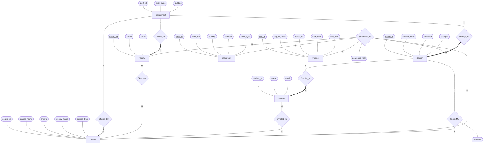

# University Timetable Generation System

A DBMS mini-project that **automatically generates a clash-free university timetable** and lets you
query and visualise it. **MySQL** is the system of record (schema, constraints, triggers, views,
stored procedures); **Neo4j** is a graph layer for relationship-heavy analytics (who can substitute
for an absent teacher, which courses collide, what happens if a class moves); a **Streamlit** app
ties it together.

- [Features](#features) · [Architecture](#architecture) · [Project structure](#project-structure)
- [Quick start](#quick-start) · [Detailed setup](#detailed-setup) · [Running the system](#running-the-system)
- [Using the web app](#using-the-web-app) · [How it works](#how-it-works) · [Configuration](#configuration-reference)
- [Verify your installation](#verify-your-installation) · [Troubleshooting](#troubleshooting)
- [Tests](#tests) · [Status and limitations](#status-and-limitations) · [Working in a team](#working-in-a-team)

---

## Features

| Area | What you get |
|---|---|
| **Relational core (MySQL)** | 11 tables from the supplied ER diagram, `UNIQUE` keys that make double-booking impossible, composite foreign keys (a teacher can only be timetabled for a course they teach, a section only for courses in its plan), triggers for room capacity and room type, 4 views, 5 stored procedures |
| **Scheduler (Python)** | Greedy "most constrained first" ordering + backtracking + randomised restarts. Hard constraints always hold; soft ones (spread across days, no long teaching runs, labs in consecutive periods) are best effort. Reports exactly what could not be placed and why. All-or-nothing saves in one transaction |
| **Graph analytics (Neo4j)** | Idempotent MySQL → Neo4j export; derived `CONFLICTS_WITH` between courses; 12 documented Cypher queries (impact of an absence, substitute finder, free rooms, shortest path between teachers, ripple effect of moving a class ...) |
| **Web UI (Streamlit)** | Weekly grids per section / faculty / room, generator control panel, "faculty absent" tool (with one-click substitute assignment and undo), clash checker (incl. "would this class be allowed?" what-if), statistics charts, CSV downloads |
| **Seed data** | 3 departments, 20 faculty, 30 courses (24 theory + 6 lab), 10 sections, 120 students, 25 rooms, 48 time slots, 600 enrollments, all deliberately feasible |

## Architecture

```
                     ┌─────────────────────────────┐
                     │   Streamlit web app          │  app/streamlit_app.py
                     │   grids · generator · absent │
                     │   clash checker · statistics │
                     └───────┬─────────────┬────────┘
                  SQL (views, procedures)  │ Cypher (12 queries)
                             │             │
        ┌────────────────────▼───┐   ETL   ┌▼─────────────────────┐
        │ MySQL / MariaDB         │ ──────► │ Neo4j (graph)         │
        │ system of record        │ src/    │ analytics, paths,     │
        │ constraints · triggers  │ neo4j_  │ conflicts, substitutes│
        └────────────▲────────────┘ etl.py  └──────────────────────┘
                     │ reads data, writes Timetable
              ┌──────┴───────┐
              │ generator.py │  greedy + backtracking scheduler
              └──────────────┘
```

**Rule of thumb:** MySQL always holds the truth. Neo4j is a *derived copy*: after you regenerate
a timetable, refresh it with the ETL (the UI has a button for it).

**Tech stack:** MySQL 8.x (also works on MariaDB) · Neo4j 5.x (Cypher) · Python 3.11+ with
`mysql-connector-python`, `neo4j`, `pandas`, `streamlit` · Docker Compose (optional).

## Project structure

```
university-timetable-system/
├── README.md                     this file
├── CONTEXT.md                    project handoff notes (decisions, status, environment quirks)
├── docker-compose.yml            MySQL 8 + Neo4j 5 containers (optional)
├── requirements.txt              Python dependencies
├── requirements-dev.txt          + pytest and ruff, for tests and linting
├── pytest.ini                    test configuration and markers
├── ruff.toml                     lint settings (`ruff check .`)
├── .github/workflows/ci.yml      GitHub Actions: lint + tests on MySQL 8/Neo4j 5 and on MariaDB
├── .env.example                  settings template -> copy to .env
├── .gitignore
├── sql/
│   ├── 01_schema.sql             original DDL from the PDF (unchanged)
│   ├── 02_migration_improvements.sql   every improvement, flagged M1-M6
│   ├── 03_seed_data.sql          sample data (generated by tools/make_seed.py)
│   └── 04_views_procedures.sql   4 views + 4 procedures
├── src/
│   ├── db.py                     connection helpers (env-driven credentials)
│   ├── utils.py                  config, error translation, slot geometry, conflict graph, grid renderer
│   ├── generator.py              the scheduler (+ "check a proposed class")
│   ├── neo4j_etl.py              MySQL -> Neo4j export, verification
│   └── neo4j_queries.py          Python access to the Cypher queries + CLI (list | demo | check)
├── cypher/
│   ├── constraints.cypher        uniqueness constraints and indexes
│   └── queries.cypher            the documented queries (single source of truth)
├── app/streamlit_app.py          the web UI
├── docs/er-diagram-chen.png      the Chen ER diagram as a rendered image
├── docker/mysql/00_app_user.sh   creates the app DB user inside the container
├── tools/
│   ├── make_seed.py              regenerates sql/03_seed_data.sql (optional)
│   └── probe_pandas.sh           diagnostic for the pandas/pyarrow crash (see Troubleshooting)
└── tests/                        automated test suite (see "Tests")
    ├── conftest.py               fixtures; safety rules (tests never touch real data)
    ├── test_schema.py            constraints, composite FKs, triggers, procedures
    ├── test_generator.py         scheduler, independent re-validation, saving, failure reports
    ├── test_etl_offline.py       ETL logic against a recording stand-in (no Neo4j needed)
    ├── test_neo4j_live.py        graph vs MySQL on a running Neo4j (auto-skips)
    ├── test_utils.py             helpers, error wording, the Cypher query file
    ├── test_project_files.py     files, docs and settings agree with each other
    └── test_ui.py                Streamlit smoke tests (opt-in)
```

---

## Quick start

Fastest path **with Docker** (any OS with Docker Desktop / Docker Engine):

```bash
git clone https://github.com/Shashankb30/university-timetable-system.git university-timetable-system && cd university-timetable-system
python3 -m venv .venv && source .venv/bin/activate      # Windows: see "Create the Python environment"
pip install -r requirements.txt
cp .env.example .env                                    # then edit: set MYSQL_PORT=3307 and your passwords
docker compose up -d --wait                             # MySQL + Neo4j (schema + seed load automatically)
python src/generator.py                                 # build the timetable
python src/neo4j_etl.py                                 # copy it into the graph
streamlit run app/streamlit_app.py                      # open http://localhost:8501
```

No Docker? Follow [Option B: native installs](#option-b-native-installs-no-docker).

---

## Detailed setup

### 1. Prerequisites

| Component | Needed for | Version | Notes |
|---|---|---|---|
| Python | everything | 3.11 – 3.13 (tested on 3.12) | The very newest Python may lack wheels for some packages; `uv` can provide 3.12 |
| MySQL **or** MariaDB | the database | MySQL 8.0.16+ (older versions silently ignore `CHECK` constraints) · MariaDB recent | Not needed if you use Docker |
| Neo4j Community | graph layer | 5.7+ (tested on **5.26.0**) | Needs **Java 17 or 21** for native installs; not needed with Docker |
| Docker + Compose | optional shortcut | any recent | Runs MySQL and Neo4j for you |
| Git | cloning | any | |

**Platform support:** developed and verified on Linux (Ubuntu/MySQL 8.0 for automated checks, Arch Linux with
MariaDB and Neo4j 5.26.0 on the author's machine). The macOS, Windows and Docker instructions follow the official
documentation of each tool but have **not** been run by the author; they are marked below. Windows users
get the smoothest experience in **WSL 2 (Ubuntu)**: follow the Linux steps there.

### 2. Get the code

```bash
git clone https://github.com/Shashankb30/university-timetable-system.git university-timetable-system
cd university-timetable-system
```

### 3. Create the Python environment

Use a virtual environment so the project's packages stay separate.

<details><summary><b>Linux / macOS (bash, zsh)</b></summary>

```bash
python3 -m venv .venv
source .venv/bin/activate
pip install -r requirements.txt
```
</details>

<details><summary><b>Linux (fish shell)</b></summary>

```fish
python3 -m venv .venv
source .venv/bin/activate.fish
pip install -r requirements.txt
```
</details>

<details><summary><b>Windows (PowerShell) <i>(not tested by the author)</i></b></summary>

```powershell
py -3.12 -m venv .venv
# if activation is blocked:  Set-ExecutionPolicy -Scope Process -ExecutionPolicy Bypass
.\.venv\Scripts\Activate.ps1
pip install -r requirements.txt
```
Command Prompt (cmd): `.venv\Scripts\activate.bat`
</details>

<details><summary><b>Any OS with <code>uv</code> (handy when the system Python is too old, too new or broken)</b></summary>

```bash
# install uv: https://docs.astral.sh/uv/getting-started/installation/
uv venv --python 3.12
source .venv/bin/activate          # fish: activate.fish   |  Windows: .venv\Scripts\Activate.ps1
uv pip install -r requirements.txt
```
</details>

### 4. Configure the settings (`.env`)

All credentials and options live in a `.env` file in the project root. It is read by every script and by
the web app, **in every shell** (no `export` / `set -x` needed) and is git-ignored.

```bash
cp .env.example .env               # Windows PowerShell: Copy-Item .env.example .env
```

Open `.env` and set your own passwords. The most important lines are explained in
[Configuration reference](#configuration-reference). Real environment variables override the file.

### 5. Databases

#### Option A: Docker

```bash
docker compose up -d --wait        # returns once both containers are healthy; first start takes ~30-60 s
docker compose ps                  # both should show (healthy)
```

- MySQL is published on host port **3307** (so it cannot clash with a MySQL/MariaDB already on your
  machine): set `MYSQL_PORT=3307` in `.env`.
- On the first start the container creates the app user and loads `sql/01` → `04` automatically
  (schema, improvements, seed data, views/procedures). **You do not run the SQL files yourself.**
- Neo4j (Browser at <http://localhost:7474>, Bolt on 7687) starts with the password from
  `NEO4J_PASSWORD` in `.env` (8+ characters).
- Stop: `docker compose down` · Wipe all data and start fresh: `docker compose down -v`.

*(Verified with Docker 29 / Compose 5. CI starts this exact stack on every pull request and runs the
whole test suite against it.)*

#### Option B: native installs (no Docker)

**B1. MySQL or MariaDB**

<details><summary><b>Ubuntu / Debian</b></summary>

```bash
sudo apt update
sudo apt install -y mysql-server
sudo systemctl enable --now mysql
```
</details>

<details><summary><b>Fedora</b></summary>

```bash
sudo dnf install -y community-mysql-server
sudo systemctl enable --now mysqld
```
</details>

<details><summary><b>Arch Linux (MariaDB, verified by the author)</b></summary>

```bash
sudo pacman -S mariadb
sudo mariadb-install-db --user=mysql --basedir=/usr --datadir=/var/lib/mysql
sudo systemctl enable --now mariadb
```
The `mysql` command here is MariaDB's client (it prints a "deprecated program name" notice). The root
account uses socket authentication: use `sudo mariadb` instead of `mysql -u root -p`.
</details>

<details><summary><b>macOS (Homebrew) <i>(not tested by the author)</i></b></summary>

```bash
brew install mysql
brew services start mysql
```
Root has no password initially: `mysql -u root`.
</details>

<details><summary><b>Windows <i>(not tested by the author)</i></b></summary>

Install "MySQL Community Server 8.0" from <https://dev.mysql.com/downloads/mysql/> (or
`winget install Oracle.MySQL`), choose a root password in the installer and make sure the `mysql`
client is on your `PATH`. Or use WSL 2 and follow the Ubuntu steps.
</details>

**B2. Create the application user** (run as the database administrator; pick your own password,
the same one you put in `.env`):

```bash
# Linux/MySQL: sudo mysql      Arch/MariaDB: sudo mariadb      macOS: mysql -u root      Windows/other: mysql -u root -p
sudo mysql
```
```sql
CREATE USER IF NOT EXISTS 'timetable'@'localhost' IDENTIFIED BY 'change_me_timetable';
CREATE USER IF NOT EXISTS 'timetable'@'127.0.0.1' IDENTIFIED BY 'change_me_timetable';
GRANT ALL PRIVILEGES ON university_timetable.* TO 'timetable'@'localhost';
GRANT ALL PRIVILEGES ON university_timetable.* TO 'timetable'@'127.0.0.1';
FLUSH PRIVILEGES;
```

**B3. Load the database.** Run from the project root, in this order. The `source` form below works on
every OS and shell (including Windows PowerShell, where `< file.sql` does not work) and understands the
`DELIMITER` lines used by the trigger and procedure files:

```bash
# use the same admin command as above in place of "sudo mysql"
sudo mysql -e "source sql/01_schema.sql"
sudo mysql -e "source sql/02_migration_improvements.sql"
sudo mysql -e "source sql/03_seed_data.sql"
sudo mysql -e "source sql/04_views_procedures.sql"
```

Run each file **once** (`01` and `02` fail if repeated: to start over run
`DROP DATABASE university_timetable;` first). Re-running `03_seed_data.sql` is safe: it empties the
tables first, **including the timetable**.

**B4. Neo4j (native).** Neo4j 5 needs Java 17 or 21.

<details><summary><b>Install Java 21</b></summary>

| OS | Command |
|---|---|
| Ubuntu / Debian | `sudo apt install -y openjdk-21-jre-headless` |
| Fedora | `sudo dnf install -y java-21-openjdk-headless` |
| Arch | `sudo pacman -S jre21-openjdk-headless && sudo archlinux-java set java-21-openjdk` |
| macOS | `brew install openjdk@21` (then follow the "link" note brew prints) |
| Windows | `winget install EclipseAdoptium.Temurin.21.JDK` |

Check with `java -version`: it must report 17 or 21.
</details>

<details><summary><b>Linux / macOS: download and start Neo4j 5.26</b></summary>

```bash
mkdir -p ~/neo4j && cd ~/neo4j
curl -O https://dist.neo4j.org/neo4j-community-5.26.0-unix.tar.gz
tar -xzf neo4j-community-5.26.0-unix.tar.gz
cd neo4j-community-5.26.0

# FIRST, before the very first start, set the password (8+ characters):
bin/neo4j-admin dbms set-initial-password change_me_neo4j

bin/neo4j console          # runs in the foreground; leave this terminal open. Ctrl+C stops it
# or:  bin/neo4j start | status | stop     (background)
```
</details>

<details><summary><b>Windows (PowerShell) <i>(not tested by the author)</i></b></summary>

```powershell
Invoke-WebRequest https://dist.neo4j.org/neo4j-community-5.26.0-windows.zip -OutFile neo4j.zip
Expand-Archive neo4j.zip -DestinationPath .
cd neo4j-community-5.26.0
bin\neo4j-admin dbms set-initial-password change_me_neo4j
bin\neo4j console
```
If a download link has moved, get Neo4j 5.26 Community from <https://neo4j.com/deployment-center/>.
</details>

When the log shows `Started.`, Neo4j is up: Browser at <http://localhost:7474> (user `neo4j`), Bolt on port
7687. The password must equal `NEO4J_PASSWORD` in `.env`. The newest Neo4j releases use calendar versions
(e.g. 2025.x); this project was verified on **5.26.0**.

---

## Running the system

All commands run from the project root with the virtual environment active.

| Step | Command | What it does |
|---|---|---|
| 1 | `python src/generator.py` | Builds the timetable for `ACADEMIC_YEAR` and saves it |
| 2 | `python src/neo4j_etl.py` | Copies MySQL data + timetable into Neo4j and verifies the counts |
| 3 | `python src/neo4j_queries.py demo` | Runs every Cypher query and prints results |
| 4 | `streamlit run app/streamlit_app.py` | Web UI at <http://localhost:8501> |

**Generator options**

```bash
python src/generator.py --dry-run                 # compute and report only, write nothing
python src/generator.py --replace                 # overwrite an existing timetable for the year
python src/generator.py --allow-partial           # keep a clash-free partial result if a complete one is impossible
python src/generator.py --year 2027-2028 --seed 7 --time-limit 60 --restarts 6
```
Exit code is `0` on success, `1` otherwise. Without `--replace` it refuses to overwrite an existing year.

**Neo4j helpers**

```bash
python src/neo4j_queries.py check      # which NEO4J_* settings are used (password masked) + a real login test
python src/neo4j_queries.py list       # the available queries
python src/neo4j_etl.py --year 2026-2027   # refresh only one year
python src/neo4j_etl.py --reset            # wipe the graph first, then rebuild
```

> **Windows/Docker note:** the web app and CLI tools run on your machine and talk to the databases over
> `localhost`; only the databases live in containers.

---

## Using the web app

Open <http://localhost:8501>. The sidebar selects the **academic year** and **page**, and shows whether MySQL
and Neo4j are connected.

| Page | What it does |
|---|---|
| **Timetable** | Weekly grid for a **section**, **faculty member** or **room** (theory blue, lab orange, lunch shown). Metrics and a CSV download |
| **Run generator** | Year, "replace existing", dry run, partial save, time limit, seed. Shows the verdict, soft-constraint counts, anything unplaced and why. After saving it offers **Update Neo4j graph** |
| **Faculty absent** *(needs Neo4j)* | Pick a teacher and a day (or whole week): classes affected, students and sections hit, and per-class substitutes. **Qualified** = teaches that course (assignable directly); **Related** = teaches a colliding course (needs a `Teaches` row first). **Assign** hands a class to the chosen substitute in the saved weekly timetable (for a Related candidate, tick the box to add the `Teaches` row in the same transaction), then refreshes the Neo4j graph; **Undo** reverses it, including the added `Teaches` row. Warns when the graph is out of date (compares classes per teacher, so a reassignment is noticed) |
| **Clash checker** | (1) audit the saved timetable (`sp_list_clashes`, `sp_hours_coverage`); (2) test a hypothetical class against every rule without saving it; (3) *Move a class*: ripple effect through Neo4j |
| **Statistics** | Faculty workload, room utilisation, classes per day/period, theory vs lab, section load, plus graph insights |

If Neo4j is not running, only the Neo4j-backed parts show a message; everything else keeps working.

---

## How it works

### From the ER diagram to the relational schema

The supplied Chen ER diagram maps to tables with three standard rules:

- **1:N** relationship → a foreign key on the "many" side: `Faculty.dept_id`, `Course.dept_id`,
  `Section.dept_id`, `Student.section_id`.
- **M:N** relationship → a junction table with a composite primary key: `Teaches` (Faculty–Course) and
  `Enrollment` (Student–Course).
- **n-ary** relationship (`Scheduled_In`) → one table with a foreign key to each participant plus its own
  attribute: `Timetable(course, faculty, room, slot, section, academic_year)`.



*Chen notation: rectangles are entities, diamonds are relationships, ovals are attributes (key attributes underlined). Edge labels give the cardinality; a thick line means total participation (every Faculty, Course, Section and Student must belong to one). `Takes` is the `Section_Course` table added by migration M1; `Scheduled_In` is stored as the `Timetable` table.*

Rendered image: [`docs/er-diagram-chen.png`](docs/er-diagram-chen.png) (for slides, reports or viewers without Mermaid).

*(In the original drawing, Offered_By and Belongs_To appear to attach to Faculty; the relational schema
in the PDF uses `dept_id` on Course and Section, which is what this project follows.)*

**Hard constraints encoded in `Timetable`:** `UNIQUE(room, slot, year)`, `UNIQUE(faculty, slot, year)`,
`UNIQUE(section, slot, year)`: MySQL itself rejects any double booking.

### Improvements added on top of the PDF schema (`sql/02_migration_improvements.sql`)

`01_schema.sql` is the PDF DDL unchanged; every change lives in the migration and is flagged:

| # | Change | Why |
|---|---|---|
| M1 | New table `Section_Course(section_id, course_id, semester)` | The PDF has no record of which courses a section must take |
| M2 | FK `Timetable(faculty_id, course_id)` → `Teaches` | A faculty member can only be timetabled for a course they teach |
| M3 | FK `Timetable(section_id, course_id)` → `Section_Course` | A section can only get courses from its plan *(extra, easy to remove)* |
| M4 | Procedure `sp_validate_placement` | One place for the capacity and room-type rules |
| M5 | Triggers on `Timetable` (insert/update) and `Section_Course` | Room capacity ≥ section strength; LAB→LAB room, THEORY→LECTURE room; semester consistency. Errors 5001/5002/5003 |
| M6 | Indexes on `Timetable`, `Classroom`, `Course` | Speed for the common lookups |

**Views:** `v_section_timetable`, `v_faculty_timetable`, `v_room_utilization`, `v_free_slots`.
**Procedures:** `sp_faculty_workload(year)`, `sp_room_utilization(year)`, `sp_list_clashes(year)` (must return
**zero rows**), `sp_hours_coverage(year)` (zero rows = every section has exactly its weekly hours).

### The scheduler (`src/generator.py`)

1. **Load** slots, sections, plans, teachers, rooms and the course *conflict graph* (courses sharing
   qualified faculty or enrolled students).
2. **Pre-flight**: cheap necessary-condition checks that explain impossible inputs immediately (a course nobody
   teaches, no room big enough, too many hours for the available teachers or slots ...).
3. **Split into tasks**: each theory period is a task; each lab becomes blocks of up to 3 consecutive periods.
4. **Order by difficulty**: labs first, then fewer qualified teachers, fewer eligible rooms, higher
   conflict-graph weight, more hours (the graph-colouring "most constrained first" idea).
5. **Search with backtracking**: for each task, enumerate every placement that satisfies all hard
   constraints, sorted by soft-constraint penalty; place the best, and undo and try the next if a later task
   gets stuck. A node/time budget with randomised restarts stops unlucky early choices from trapping the search.
6. **Failure handling**: if no complete timetable is found, a no-backtracking pass places what it can and
   explains every class it cannot ("31 of 48 slots already used by the section, 12 have every qualified teacher busy ...").
7. **Save** in one transaction; MySQL errors (`1062` unique clash, `1452` foreign key, `5001-5003` triggers)
   are translated into plain English and roll everything back.

*Hard:* no room / teacher / section double-booked; room type and capacity fit; teacher in `Teaches`; exactly
`weekly_hours` per course per section. *Soft (best effort):* spread a course across days, never the same course
twice in a day, at most 3 consecutive periods per teacher, lab periods consecutive (never across lunch).

### The graph layer (Neo4j)

`src/neo4j_etl.py` copies MySQL into Neo4j with `MERGE` (safe to repeat): constraints and indexes first, then
nodes, relationships, the timetable, and finally the derived `CONFLICTS_WITH`. Relationships whose MySQL row was
deleted (for example a `Teaches` row removed by an undo) are pruned, so the graph never keeps ghosts.

| Nodes | Relationships |
|---|---|
| Department, Faculty, Course, Section, Student, Classroom, TimeSlot | `WORKS_IN`, `TEACHES`, `STUDIES_IN`, `ENROLLED_IN`, `OFFERED_BY`, `SCHEDULED_IN` (Course→Section, one per timetable row, carrying room, slot, teacher, year), `CONFLICTS_WITH` (Course–Course, `shared_faculty`, `shared_students`, `shared_count`); extras `BELONGS_TO`, `TAKES`, `TEACHES_SECTION` |

The 12 queries live in `cypher/queries.cypher` (fully commented; the Python code runs exactly that file):

| Query | Answers |
|---|---|
| `impact_analysis` | Which classes (and how many students) are lost if a teacher is absent? |
| `substitute_finder` | Same-department colleagues free in each affected slot, qualified or related |
| `most_conflicted_courses` | Which courses collide with the most others? |
| `free_rooms` | Free rooms in a slot by minimum capacity and type |
| `heaviest_day_students` | Students whose busiest day has the most periods |
| `faculty_shortest_path` | Shortest chain between two teachers via shared courses or sections |
| `faculty_workload` | Teachers ranked by weekly periods |
| `move_class_ripple` | What collides if one class moves to another slot? |
| `cross_department_teaching` | Teachers qualified for another department's courses |
| `course_conflict_neighbours` | The collision neighbourhood of one course |
| `node_counts`, `relationship_counts` | Graph size (used to verify the ETL) |

### Why MySQL **and** Neo4j?

- **MySQL** is the right home for the timetable itself: strict schemas, foreign keys, unique constraints,
  triggers and transactions guarantee that no invalid timetable can ever be stored. Weekly grids, totals and
  utilisation are classic set-based SQL.
- **Neo4j** is the right tool for *connected* questions: "who can cover for X?", "how are these two
  teachers linked?", "what else breaks if I move this class?" are multi-hop traversals that need several
  self-joins in SQL but a single readable pattern in Cypher.
- Keeping MySQL as the single source of truth and treating Neo4j as a rebuildable copy avoids
  consistency problems: if the graph is ever stale or damaged, `python src/neo4j_etl.py --reset` rebuilds it.

### Sample data (`sql/03_seed_data.sql`)

3 departments (CSE, ECE, Mechanical) · 20 faculty · 30 courses (24 theory, 6 lab; labs are 2 periods) ·
10 sections in odd semesters 3 and 5 · 120 students (12 per section; `Section.strength` of 45–60 is the declared
class size used for capacity checks) · 25 rooms (18 lecture, 7 lab) · 48 slots (Mon–Sat × 8 periods, lunch
between periods 4 and 5) · 62 `Teaches`, 50 `Section_Course`, 600 `Enrollment` rows. Two teachers are qualified
across departments so the graph has bridges. Every section needs 15–16 of 48 slots and every course has at least
two qualified teachers, so a clash-free timetable always exists.
`python tools/make_seed.py` regenerates the file deterministically.

---

## Configuration reference

Set in `.env` (see `.env.example`). Real environment variables take precedence.

| Variable | Default | Meaning |
|---|---|---|
| `MYSQL_HOST` | `127.0.0.1` | Database host |
| `MYSQL_PORT` | `3306` | `3306` for a local server, `3307` for the Docker container |
| `MYSQL_USER` | *(required)* | Application user (`timetable`), **not** root |
| `MYSQL_PASSWORD` | *(empty)* | Its password |
| `MYSQL_DATABASE` | `university_timetable` | Database name |
| `MYSQL_UNIX_SOCKET` | *(unset)* | Connect through a socket instead of TCP (local Linux/macOS) |
| `NEO4J_URI` | `bolt://localhost:7687` | Bolt address |
| `NEO4J_USER` | `neo4j` | Neo4j user |
| `NEO4J_PASSWORD` | *(required)* | Must equal the password Neo4j was set up with (8+ chars) |
| `NEO4J_DATABASE` | `neo4j` | Community Edition has only this database |
| `ACADEMIC_YEAR` | `2026-2027` | Year used by default everywhere |
| `MYSQL_ROOT_PASSWORD`, `MYSQL_HOST_PORT` | *(Docker only)* | Container root password; published host port (default 3307) |

---

## Verify your installation

Work through this list; each line says what you should see. (Commands for the database checks use `sudo mysql`;
substitute your own admin command, or use the `timetable` user.)

| # | Check | Command | Expected |
|---|---|---|---|
| 1 | Schema loaded | `mysql ... -e "SHOW FULL TABLES" university_timetable` | 11 base tables + 4 views |
| 2 | Seed loaded | `SELECT COUNT(*) FROM Faculty; SELECT COUNT(*) FROM Student; SELECT COUNT(*) FROM Enrollment;` | 20 · 120 · 600 |
| 3 | Rules installed | `SELECT COUNT(*) FROM information_schema.triggers WHERE trigger_schema='university_timetable';` | 4 |
| 4 | Generator dry run | `python src/generator.py --dry-run` | `Result: COMPLETE`, `Periods placed: 154 / 154` |
| 5 | Generator saves | `python src/generator.py` | `Saved to MySQL: yes (154 rows)` |
| 6 | No clashes | `CALL sp_list_clashes('2026-2027');` | **empty result** |
| 7 | Hours correct | `CALL sp_hours_coverage('2026-2027');` | **empty result** |
| 8 | Neo4j login | `python src/neo4j_queries.py check` | `Connection: OK` |
| 9 | ETL | `python src/neo4j_etl.py` | `Verification: OK, graph matches MySQL`; running it twice gives identical counts |
| 10 | Graph size | `python src/neo4j_queries.py demo` (first tables) | nodes 3/20/30/10/120/25/48; `SCHEDULED_IN` 154, `CONFLICTS_WITH` 91, `TEACHES_SECTION` 80, `TEACHES` 62, `ENROLLED_IN` 600 |
| 11 | Web app | `streamlit run app/streamlit_app.py` | Timetable grid for "CSE / Sem 3 / A" shows 15 periods; sidebar shows MySQL and Neo4j connected |
| 12 | Constraints bite | In the app: *Clash checker → Check a proposed class*, choose a THEORY course with a LAB room | "MySQL would REJECT this class" |
| 13 | Whole test suite | `pytest` | `90 passed, 17 skipped` (no Neo4j) · `97 passed, 10 skipped` with Neo4j loaded · `106 passed, 1 skipped` with `RUN_UI_TESTS=1` |

---

## Troubleshooting

<details><summary><b>MySQL / MariaDB</b></summary>

| Symptom | Cause and fix |
|---|---|
| `mysql: Deprecated program name ... use mariadb` | Your `mysql` is MariaDB's client; harmless. Use `mariadb` / `sudo mariadb` |
| `ERROR 1698 Access denied for user 'root'@'localhost'` | Root uses socket authentication (Linux/MariaDB/Ubuntu): run the client with `sudo`, and create the `timetable` user for the Python code |
| Python says `Access denied` for `timetable` | Wrong `MYSQL_PASSWORD` in `.env`, or the user was not created for both `'localhost'` and `'127.0.0.1'`; or set `MYSQL_UNIX_SOCKET` |
| `Could not use MySQL: 2003 ... Connection refused` | The database server is not running, or `MYSQL_HOST` / `MYSQL_PORT` are wrong (3306 local, 3307 Docker). Start the server and retry |
| `Could not use MySQL: 1045 Access denied` | Wrong `MYSQL_USER` / `MYSQL_PASSWORD` in `.env`, or the user was not created (step B2) |
| `MYSQL_USER is not set` | `.env` missing or in the wrong folder. It must be in the project root, next to `src/` |
| Errors around `DELIMITER` when loading `02` / `04` | Load with the command-line client (`-e "source ..."`), not Workbench or Python |
| `01_schema.sql` fails: database exists / `02` fails: already exists | Files are one-shot. `DROP DATABASE university_timetable;` and start again |
| Cannot delete a `Teaches` row | Intended: the composite foreign key protects timetable rows that use it. Clear `Timetable` first or re-run `03_seed_data.sql` |
| Port 3306 already in use with Docker | Keep the default `MYSQL_HOST_PORT=3307` and `MYSQL_PORT=3307` in `.env` |
| Windows PowerShell rejects `< file.sql` | Use `mysql -u root -p -e "source sql/01_schema.sql"` |
</details>

<details><summary><b>Neo4j</b></summary>

| Symptom | Cause and fix |
|---|---|
| `ServiceUnavailable` / connection refused on 7687 | Neo4j is not running. Start it (`bin/neo4j console`, or `docker compose up -d`). Sidebar shows "Neo4j: unavailable" |
| `AuthError` / unauthorized | `NEO4J_PASSWORD` in `.env` is not the password Neo4j has. Run `python src/neo4j_queries.py check` (shows where the value comes from and whether a real environment variable overrides `.env`). A fresh Neo4j starts with user/password `neo4j`/`neo4j` and forces a change on first browser login |
| Need to reset the password (nothing stored yet) | Stop Neo4j (`bin/neo4j stop`, check with `status`), `rm -rf data/databases data/transactions`, `bin/neo4j-admin dbms set-initial-password <new>`, start again. `set-initial-password` only works **while Neo4j is stopped and before its first start** |
| Neo4j does not start | `java -version` must report 17 or 21; check that ports 7474/7687 are free |
| "graph is out of date" in the app | You regenerated the timetable. Click **Update Neo4j graph** or run `python src/neo4j_etl.py` |
| ETL says `MISMATCH` | Re-run with `--reset`; if it persists, compare the listed counts with MySQL |
</details>

<details><summary><b>Python, the web app and the generator</b></summary>

| Symptom | Cause and fix |
|---|---|
| `Segmentation fault` right after `import pandas` / when Streamlit starts | A pandas + pyarrow crash seen when running inside the **Flatpak build of VS Code** (its terminal is a sandbox; pandas alone works, pandas with pyarrow crashes). Run `streamlit` (and `RUN_UI_TESTS=1 pytest -m ui`) from a normal system terminal outside VS Code. `bash tools/probe_pandas.sh` diagnoses it. The generator, ETL, Neo4j queries and the default `pytest` run do not need pandas and work anywhere. *The Neo4j driver itself loads pandas and pyarrow when they are installed; `utils.get_neo4j_driver` keeps them out so the Neo4j tools keep working in such a terminal* |
| `ImportError ... GLIBC_x.y not found` from the system Python | Half-finished system upgrade (seen on Arch). Finish with a full `sudo pacman -Syu` (never `-Sy` alone) and reboot, or use a `uv`-provided Python (`uv venv --python 3.12`) |
| `uv: command not found` | `uv` lives in `~/.local/bin`; add it to `PATH` or call `~/.local/bin/uv` |
| Environment variables do not stick / different syntax in bash vs fish vs PowerShell | Put everything in `.env`; the code reads it in every shell |
| `Timetable ... already has rows; pass --replace` | Intended safety. Use `--replace` to overwrite |
| Generator: `PARTIAL` / `FAILED` with reasons | Read the "Could NOT be placed" lines (e.g. every qualified teacher busy, no free room of that type). Fix the data, or add `--allow-partial` to keep a partial result |
| Generator: "input data makes a timetable impossible" | Pre-flight found a necessary condition that fails (course with no teacher, no big enough room ...). The message names the course |
| Streamlit page blank / "Cannot connect to MySQL" | Check `.env`, that the database server is running, then reload |
</details>

---

## Tests

```bash
pip install -r requirements-dev.txt          # adds pytest and ruff
pytest                                       # everything that can run (needs MySQL + .env)
pytest -m neo4j                              # only the live-Neo4j checks (Neo4j running, ETL done)
RUN_UI_TESTS=1 pytest -m ui                  # Streamlit smoke tests, opt-in (see below)
ruff check .                                 # lint (same check as CI)
```

PowerShell: `$env:RUN_UI_TESTS=1; pytest -m ui` · fish: `env RUN_UI_TESTS=1 pytest -m ui`.

**Safety:** the tests never change your real timetable. Anything that writes uses a throw-away academic year
(`2099-2100`, wiped before and after) or a transaction that is rolled back; the Neo4j tests only read.

| File | What it proves |
|---|---|
| `test_schema.py` | Object counts and seed sizes; `CHECK` constraints; a room, teacher or section **cannot be double-booked** (errors named by constraint); the **triggers** reject a too-small room and a wrong room type (5001/5002) and a wrong semester (5003); a teacher must be in `Teaches` and a course in the section's plan (composite FKs); a `Teaches` row in use cannot be deleted; `sp_list_clashes` catches drift the triggers cannot see |
| `test_generator.py` | A complete timetable is found; an **independent checker** (written from the raw tables, not from generator internals) confirms every hard rule and the exact weekly hours; soft constraints met on the seed data; labs consecutive and never across lunch; same seed ⇒ same result; saved timetable passes `sp_list_clashes` and `sp_hours_coverage` with zero rows; refuses to overwrite; a bad row **rolls back the whole save**; impossible input is explained, not crashed on; when the search runs out of budget the partial result is still clash-free, every unplaced class has a reason, and nothing is saved; CLI exit codes (0 / 2 when MySQL is unreachable) |
| `test_etl_offline.py` | Without Neo4j: constraints are created first, nodes before relationships, the old timetable is deleted before reload, rows sent equal the MySQL counts, every static relationship type is pruned against MySQL, batches never exceed 500; `--year` verification covers every year in the graph; a friendly exit code 2 when Neo4j is unreachable |
| `test_neo4j_live.py` | With Neo4j: every node/relationship count equals MySQL; `CONFLICTS_WITH` built in Neo4j **equals** the SQL definition; workload totals, absence plans, free rooms, shortest paths and the move-ripple agree with MySQL |
| `test_utils.py` | Times, lunch-aware slot links, the weekly grid and its HTML escaping, error wording, `.env` parsing, masked password report, all 12 queries load and each wrapper passes exactly the parameters its query uses, and importing the Neo4j driver never loads pandas or pyarrow |
| `test_project_files.py` | Required files exist; every setting the code reads is in `.env.example`; `.env` is git-ignored; `sql/03_seed_data.sql` is byte-identical to what `tools/make_seed.py` generates; the README's options, links and file names are real |
| `test_db.py` | `db.transaction` commits/rolls back, `db.call_procedure` works with both forms of mysql-connector's `stored_results`, a missing `MYSQL_USER` is reported (no database needed) |
| `test_substitutes.py` | Assigning a qualified substitute keeps the timetable clash-free and can be undone; a busy teacher is refused; an unqualified one needs the `Teaches` row, which undo removes again; an undo that cannot drop that row (now used by another class) changes nothing; bad requests are explained. Uses the throw-away year and restores `Teaches` |
| `test_ui.py` | Every page of the web app loads, the grid shows the timetable, and the absent page offers substitute assignment (opt-in; imports pandas) |

**Expected result on the bundled data:**

| Situation | Summary line |
|---|---|
| MySQL only (no Neo4j, UI not enabled) | `90 passed, 17 skipped` |
| + Neo4j running with the graph loaded | `97 passed, 10 skipped` |
| + `RUN_UI_TESTS=1` | `106 passed, 1 skipped` |

The one remaining skip is `test_cypher_files_have_valid_syntax`, which needs the optional `cypher-lint` tool
(Debian/Ubuntu: `sudo apt install cypher-lint`); with it installed that test runs too.

Skips are explained in the summary (`-ra`): "Neo4j not reachable", "graph is empty, run the ETL", or "UI tests are opt-in".
Skipped is not failed, but it also means **not checked**: run the Neo4j tests at least once.

*UI tests and the Flatpak VS Code terminal:* they import pandas, which crashes inside that terminal (see
Troubleshooting). Run them from a normal terminal. A crash cannot be caught by pytest, which is why they are opt-in.

*Do the tests really catch mistakes?* Checked by sabotage: dropping the `fk_tt_teaches` foreign key, the capacity
trigger, the unique key on teachers, or changing the seed data each made the matching tests fail.
The live-Neo4j tests pass against a real Neo4j 5.26.0 (verified on Arch Linux with MariaDB).

### Continuous integration

`.github/workflows/ci.yml` runs on every pull request and every push to `main`:

| Job | What it does |
|---|---|
| `lint` | `ruff check .`, `docker compose config`, and `bash -n` on the shell scripts |
| `test-docker-compose` | Starts MySQL 8.0 + Neo4j 5.26 with `docker compose up -d --wait` (the Docker path above), runs the generator, the ETL and `neo4j_queries.py demo`, then the **whole** suite including the UI tests (Python 3.12) |
| `test-mariadb` | Loads the SQL files into MariaDB 11.4 with its own client, runs the generator and the suite (Python 3.11, no Neo4j, so the 7 live-Neo4j tests and the UI substitute test skip) |

## Status and limitations

| Part | Status |
|---|---|
| Schema, migration, views, procedures, seed data | Done; verified on MySQL 8.0 and MariaDB |
| Scheduler | Done; verified on MySQL 8.0 and MariaDB |
| Neo4j ETL and queries | Done; verified on Neo4j 5.26.0 |
| Web app | Done; headless-tested and seen working in a browser; run it from a normal terminal |
| Docker Compose | Done; verified (MySQL 8.0 + Neo4j 5.26) and exercised by CI |
| Substitute assignment | Done; tested against MySQL 8.0 and MariaDB, and clicked through in a browser (assign, add `Teaches`, undo) |
| Automated test suite | Done: 106 tests pass with MySQL 8.0 + Neo4j 5.26 (97 without the opt-in UI tests, 90 need only MySQL); also green on MariaDB |
| Continuous integration | GitHub Actions: lint + tests on MySQL 8/Neo4j 5 (docker compose) and on MariaDB 11.4 |

Known limitations (by design, for a mini-project):

- Triggers fire on `Timetable` writes only: lowering a room's capacity *after* scheduling is not blocked, but
  `sp_list_clashes` reports it.
- A class has one teacher and one room; no split batches or team teaching. A lab uses a lab room big enough for the
  whole section.
- Students take their section's plan (`Section_Course`); individual electives/backlogs are not modelled, so
  student-level clashes cannot occur by construction.
- The generator is a heuristic: it finds a feasible timetable fast on the seed data, but very tight inputs
  can exceed the time budget (it then reports a partial result with reasons).
- The Neo4j graph is a copy: refresh it after regenerating the timetable (the web app does this itself after a
  substitute assignment).
- Assigning a substitute changes the **weekly** timetable. A one-day cover (this Monday only) is not modelled;
  it would need a dated substitutions table.
- The web app has no login; run it locally. Do not expose Streamlit or the databases to the internet with
  the sample passwords.

## Working in a team

- Copy `.env.example` to `.env` and use your own passwords. **Never commit `.env`** (it is git-ignored).
- Run `pytest` and `ruff check .` before you commit; add a test with every rule you add. CI runs both on
  every pull request.
- Change the database through **new migration files** (`sql/05_...sql`), not by editing the applied ones.
- Teammates can use different servers (MySQL vs MariaDB): everything uses standard SQL and the portable
  `source` loading command.
- `CONTEXT.md` records decisions, the verified state and environment quirks; update it when you change
  something significant.

## License

No license has been chosen yet. Add a `LICENSE` file (for example MIT) before publishing the repository.