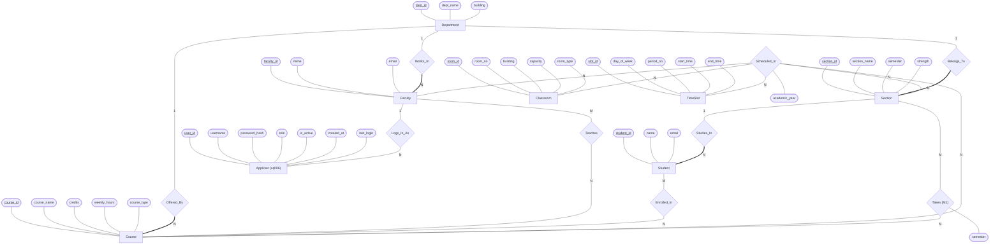

# University Timetable Generation System

A DBMS mini-project that **automatically generates a clash-free university timetable** and lets you
query and visualise it. **MySQL** is the system of record (schema, constraints, triggers, views,
stored procedures); **Neo4j** is a graph layer for relationship-heavy analytics (who can substitute
for an absent teacher, which courses collide, what happens if a class moves); a **Next.js** web app
talks to a **FastAPI** backend that ties it together, with logins and two roles enforced inside MySQL.

- [Features](#features) · [Architecture](#architecture) · [Project structure](#project-structure)
- [Quick start](#quick-start) · [Detailed setup](#detailed-setup) · [Running the system](#running-the-system)
- [Using the web app](#using-the-web-app) · [Authentication and role-based access](#authentication-and-role-based-access)
- [How it works](#how-it-works) · [Advanced SQL](#advanced-sql-function-cte-recursive-cte) · [Neo4j RUD](#neo4j-read-update-delete-the-graph-page)
- [Configuration](#configuration-reference) · [Verify your installation](#verify-your-installation) · [Troubleshooting](#troubleshooting)
- [Tests](#tests) · [Status and limitations](#status-and-limitations) · [Working in a team](#working-in-a-team)

---

## Features

| Area | What you get |
|---|---|
| **Relational core (MySQL)** | 11 tables from the supplied ER diagram + `AppUser`, `UNIQUE` keys that make double-booking impossible, composite foreign keys (a teacher can only be timetabled for a course they teach, a section only for courses in its plan), triggers for room capacity and room type, 4 views, 7 stored procedures and a stored function |
| **Advanced SQL** | `fn_faculty_load` (stored function), `sp_department_summary` (several CTEs + a window function), `sp_free_blocks` (recursive CTE): see [Advanced SQL](#advanced-sql-function-cte-recursive-cte) |
| **Scheduler (Python)** | Greedy "most constrained first" ordering + backtracking + randomised restarts. Hard constraints always hold; soft ones (spread across days, no long teaching runs, labs in consecutive periods) are best effort. Reports exactly what could not be placed and why. All-or-nothing saves in one transaction |
| **Graph analytics (Neo4j)** | Idempotent MySQL → Neo4j export; derived `CONFLICTS_WITH` between courses; 12 documented analytic Cypher queries (impact of an absence, substitute finder, free rooms, shortest path between teachers, ripple effect of moving a class ...) plus read / update / delete queries for the Graph page (node browser, faculty unavailability marks) |
| **Web app (Next.js + FastAPI)** | Login, weekly grids per section / faculty / room with free blocks, generator control panel, "faculty absent" tool (with one-click substitute assignment and undo), clash checker (incl. "would this class be allowed?" what-if), statistics with a department summary, Neo4j graph browser and unavailability editor, CSV downloads |
| **Authentication and roles** | `AppUser` table with PBKDF2 password hashes, signed httpOnly session cookie, roles **admin** and **faculty**. Each request runs on a MySQL account that holds only the matching SQL role (`tt_admin` / `tt_faculty`), so the database itself refuses a faculty write |
| **Seed data** | 3 departments, 20 faculty, 30 courses (24 theory + 6 lab), 10 sections, 120 students, 25 rooms, 48 time slots, 600 enrollments, all deliberately feasible; 3 demo logins |

## Architecture

```
          ┌──────────────────────────────────┐
browser ─►│ Next.js web app (web/)           │  pages: login · timetable · generator · absent
          │ React, TypeScript, port 3000     │  clash checker · statistics · graph
          └────────────────┬─────────────────┘
                           │ /api/* proxied (same origin, httpOnly cookie tt_session)
          ┌────────────────▼─────────────────┐
          │ FastAPI backend (api/), port 8000│  login, roles, JSON routes;
          │ reuses src/ (generator, ETL,     │  reuses the Python modules below
          │ Neo4j queries)                   │
          └──────┬──────────────────┬────────┘
  SQL as tt_admin│or tt_faculty     │ Cypher (12 analytic queries + graph RUD)
   (SET ROLE)    │                  │
        ┌────────▼────────────────┐   ETL   ┌▼──────────────────────┐
        │ MySQL / MariaDB         │ ──────► │ Neo4j (graph)          │
        │ system of record        │ src/    │ analytics, paths,      │
        │ constraints · triggers  │ neo4j_  │ conflicts, substitutes,│
        │ roles · AppUser         │ etl.py  │ unavailability marks   │
        └────────────▲────────────┘         └───────────────────────┘
                     │ reads data, writes Timetable
              ┌──────┴───────┐
              │ generator.py │  greedy + backtracking scheduler (also runs from the web app)
              └──────────────┘
```

**Rule of thumb:** MySQL always holds the truth. Neo4j is a *derived copy*: after you regenerate
a timetable, refresh it with the ETL (the web app has a button for it). The one exception is the faculty
unavailability marks, which live only in Neo4j (see [Neo4j RUD](#neo4j-read-update-delete-the-graph-page)).

**Tech stack:** MySQL 8.x (also works on MariaDB) · Neo4j 5.x (Cypher) · Python 3.11+ with
`mysql-connector-python`, `neo4j`, `fastapi`, `uvicorn` · Node.js 22 with Next.js 15, React 19, TypeScript
(tests: Vitest + Testing Library) · Docker Compose (optional).

## Project structure

```
university-timetable-system/
├── README.md                     this file
├── CONTEXT.md                    project handoff notes (decisions, status, environment quirks)
├── docker-compose.yml            MySQL 8 + Neo4j 5 containers (optional)
├── requirements.txt              Python dependencies
├── requirements-dev.txt          + pytest, ruff and httpx, for tests and linting
├── pytest.ini                    test configuration and markers
├── ruff.toml                     lint settings (`ruff check .`)
├── .github/workflows/ci.yml      GitHub Actions: lint, web app, tests on MySQL 8/Neo4j 5 and on MariaDB
├── .env.example                  settings template -> copy to .env
├── .gitignore
├── sql/
│   ├── 01_schema.sql             original DDL from the PDF (unchanged)
│   ├── 02_migration_improvements.sql   every improvement, flagged M1-M6
│   ├── 03_seed_data.sql          sample data (generated by tools/make_seed.py)
│   ├── 04_views_procedures.sql   4 views + 4 procedures
│   ├── 05_advanced_sql.sql       stored function, CTE procedure, recursive-CTE procedure
│   └── 06_auth_roles.sql         AppUser table + demo logins, SQL roles tt_admin / tt_faculty
├── src/
│   ├── db.py                     connection helpers (env-driven credentials, role accounts + SET ROLE)
│   ├── utils.py                  config, error translation, slot geometry, conflict graph, grid builder
│   ├── generator.py              the scheduler (+ "check a proposed class", substitute assignment)
│   ├── neo4j_etl.py              MySQL -> Neo4j export, verification
│   └── neo4j_queries.py          Python access to the Cypher queries + CLI (list | demo | check)
├── cypher/
│   ├── constraints.cypher        uniqueness constraints and indexes
│   └── queries.cypher            the documented queries (single source of truth)
├── api/                          FastAPI backend
│   ├── auth.py                   PBKDF2 hashing, signed session tokens, AppUser lookup
│   └── main.py                   the JSON routes (uvicorn api.main:app)
├── web/                          Next.js web app (App Router, TypeScript)
│   ├── app/                      pages: login/ and (main)/ timetable, generator, absent, clashes, statistics, graph
│   ├── components/               WeekGrid, DataTable, BarChart, Sidebar, Metric, Alert ...
│   ├── lib/                      API client, CSV export, shared types
│   ├── tests/                    Vitest + Testing Library unit tests
│   ├── middleware.ts             sends visitors without a session to /login
│   ├── next.config.ts            proxies /api/* to the FastAPI server (API_URL)
│   └── package.json              npm scripts: dev, build, start, lint, test
├── docs/er-diagram-chen.png      the Chen ER diagram as a rendered image
├── docker/mysql/
│   ├── 00_app_user.sh            creates the app (service) DB user inside the container
│   └── 07_role_accounts.sh       creates the two role login accounts used by the API
├── tools/
│   └── make_seed.py              regenerates sql/03_seed_data.sql (optional)
└── tests/                        automated Python test suite (see "Tests")
    ├── conftest.py               fixtures; safety rules (tests never touch real data)
    ├── test_schema.py            constraints, composite FKs, triggers, procedures
    ├── test_advanced_sql.py      the stored function, the CTE and the recursive CTE
    ├── test_generator.py         scheduler, independent re-validation, saving, failure reports
    ├── test_substitutes.py       assigning and undoing a substitute teacher
    ├── test_etl_offline.py       ETL logic against a recording stand-in (no Neo4j needed)
    ├── test_neo4j_live.py        graph vs MySQL, unavailability marks, on a running Neo4j (auto-skips)
    ├── test_auth.py              password hashing and session tokens
    ├── test_roles.py             the SQL roles: what each role account may and may not do
    ├── test_api.py               every API route through FastAPI's TestClient, admin vs faculty
    ├── test_db.py                connection and transaction helpers
    ├── test_utils.py             helpers, error wording, the Cypher query file
    └── test_project_files.py     files, docs and settings agree with each other
```

---

## Quick start

Fastest path **with Docker** (any OS with Docker Desktop / Docker Engine) and **Node.js 22**:

```bash
git clone https://github.com/Shashankb30/university-timetable-system.git university-timetable-system && cd university-timetable-system
python3 -m venv .venv && source .venv/bin/activate      # Windows: see "Create the Python environment"
pip install -r requirements.txt
cp .env.example .env                                    # then edit: set MYSQL_PORT=3307, your passwords and APP_SECRET
docker compose up -d --wait                             # MySQL + Neo4j (schema, seed, roles and logins load automatically)
python src/generator.py                                 # build the timetable
python src/neo4j_etl.py                                 # copy it into the graph
uvicorn api.main:app --port 8000                        # the API (leave running; API docs at http://127.0.0.1:8000/docs)
```

In a second terminal:

```bash
cd web && npm ci && npm run dev                         # open http://localhost:3000 and log in as admin / admin123
```

No Docker? Follow [Option B: native installs](#option-b-native-installs-no-docker).

---

## Detailed setup

### 1. Prerequisites

| Component | Needed for | Version | Notes |
|---|---|---|---|
| Python | everything | 3.11 – 3.13 (tested on 3.12) | The very newest Python may lack wheels for some packages; `uv` can provide 3.12 |
| MySQL **or** MariaDB | the database | MySQL 8.0.16+ (older versions silently ignore `CHECK` constraints) · MariaDB recent | Not needed if you use Docker |
| Neo4j Community | graph layer | 5.7+ (tested on **5.26.0**) | Needs **Java 17 or 21** for native installs; not needed with Docker |
| Node.js + npm | the web app (`web/`) | Node **22** LTS (tested on 22.23 / npm 10) | <https://nodejs.org/> or your package manager (`nvm install 22`) |
| Docker + Compose | optional shortcut | any recent | Runs MySQL and Neo4j for you |
| Git | cloning | any | |

**Platform support:** developed and verified on Linux (Ubuntu/MySQL 8.0 for automated checks, Arch Linux with
MariaDB and Neo4j 5.26.0 on the author's machine). The macOS, Windows and Docker instructions follow the official
documentation of each tool but have **not** been run by the author; they are marked below. Windows users
get the smoothest experience in **WSL 2 (Ubuntu)**: follow the Linux steps there.

### 2. Get the code

```bash
git clone https://github.com/Shashankb30/university-timetable-system.git university-timetable-system
cd university-timetable-system
```

### 3. Create the Python environment

Use a virtual environment so the project's packages stay separate.

<details><summary><b>Linux / macOS (bash, zsh)</b></summary>

```bash
python3 -m venv .venv
source .venv/bin/activate
pip install -r requirements.txt
```
</details>

<details><summary><b>Linux (fish shell)</b></summary>

```fish
python3 -m venv .venv
source .venv/bin/activate.fish
pip install -r requirements.txt
```
</details>

<details><summary><b>Windows (PowerShell) <i>(not tested by the author)</i></b></summary>

```powershell
py -3.12 -m venv .venv
# if activation is blocked:  Set-ExecutionPolicy -Scope Process -ExecutionPolicy Bypass
.\.venv\Scripts\Activate.ps1
pip install -r requirements.txt
```
Command Prompt (cmd): `.venv\Scripts\activate.bat`
</details>

<details><summary><b>Any OS with <code>uv</code> (handy when the system Python is too old, too new or broken)</b></summary>

```bash
# install uv: https://docs.astral.sh/uv/getting-started/installation/
uv venv --python 3.12
source .venv/bin/activate          # fish: activate.fish   |  Windows: .venv\Scripts\Activate.ps1
uv pip install -r requirements.txt
```
</details>

### 4. Configure the settings (`.env`)

All credentials and options live in a `.env` file in the project root. It is read by every script and by
the API, **in every shell** (no `export` / `set -x` needed) and is git-ignored.

```bash
cp .env.example .env               # Windows PowerShell: Copy-Item .env.example .env
```

Open `.env` and set your own passwords and a random `APP_SECRET`
(`python -c "import secrets; print(secrets.token_urlsafe(32))"`). The most important lines are explained in
[Configuration reference](#configuration-reference). Real environment variables override the file.

### 5. Databases

#### Option A: Docker

```bash
docker compose up -d --wait        # returns once both containers are healthy; first start takes ~30-60 s
docker compose ps                  # both should show (healthy)
```

- MySQL is published on host port **3307** (so it cannot clash with a MySQL/MariaDB already on your
  machine): set `MYSQL_PORT=3307` in `.env`.
- On the first start the container creates the app user, loads `sql/01` → `06` automatically
  (schema, improvements, seed data, views/procedures, advanced SQL, logins and SQL roles) and then creates the
  two role accounts with `docker/mysql/07_role_accounts.sh`. **You do not run the SQL files yourself.**
  The init scripts only run on an empty volume: after pulling new SQL files run `docker compose down -v` once.
- Neo4j (Browser at <http://localhost:7474>, Bolt on 7687) starts with the password from
  `NEO4J_PASSWORD` in `.env` (8+ characters).
- Stop: `docker compose down` · Wipe all data and start fresh: `docker compose down -v`.

*(Verified with Docker 29 / Compose 5. CI starts this exact stack on every pull request and runs the
whole test suite against it.)*

#### Option B: native installs (no Docker)

**B1. MySQL or MariaDB**

<details><summary><b>Ubuntu / Debian</b></summary>

```bash
sudo apt update
sudo apt install -y mysql-server
sudo systemctl enable --now mysql
```
</details>

<details><summary><b>Fedora</b></summary>

```bash
sudo dnf install -y community-mysql-server
sudo systemctl enable --now mysqld
```
</details>

<details><summary><b>Arch Linux (MariaDB, verified by the author)</b></summary>

```bash
sudo pacman -S mariadb
sudo mariadb-install-db --user=mysql --basedir=/usr --datadir=/var/lib/mysql
sudo systemctl enable --now mariadb
```
The `mysql` command here is MariaDB's client (it prints a "deprecated program name" notice). The root
account uses socket authentication: use `sudo mariadb` instead of `mysql -u root -p`.
</details>

<details><summary><b>macOS (Homebrew) <i>(not tested by the author)</i></b></summary>

```bash
brew install mysql
brew services start mysql
```
Root has no password initially: `mysql -u root`.
</details>

<details><summary><b>Windows <i>(not tested by the author)</i></b></summary>

Install "MySQL Community Server 8.0" from <https://dev.mysql.com/downloads/mysql/> (or
`winget install Oracle.MySQL`), choose a root password in the installer and make sure the `mysql`
client is on your `PATH`. Or use WSL 2 and follow the Ubuntu steps.
</details>

**B2. Create the application user** (run as the database administrator; pick your own password,
the same one you put in `.env`):

```bash
# Linux/MySQL: sudo mysql      Arch/MariaDB: sudo mariadb      macOS: mysql -u root      Windows/other: mysql -u root -p
sudo mysql
```
```sql
CREATE USER IF NOT EXISTS 'timetable'@'localhost' IDENTIFIED BY 'change_me_timetable';
CREATE USER IF NOT EXISTS 'timetable'@'127.0.0.1' IDENTIFIED BY 'change_me_timetable';
GRANT ALL PRIVILEGES ON university_timetable.* TO 'timetable'@'localhost';
GRANT ALL PRIVILEGES ON university_timetable.* TO 'timetable'@'127.0.0.1';
FLUSH PRIVILEGES;
```

**B3. Load the database.** Run from the project root, in this order. The `source` form below works on
every OS and shell (including Windows PowerShell, where `< file.sql` does not work) and understands the
`DELIMITER` lines used by the trigger and procedure files:

```bash
# use the same admin command as above in place of "sudo mysql"
sudo mysql -e "source sql/01_schema.sql"
sudo mysql -e "source sql/02_migration_improvements.sql"
sudo mysql -e "source sql/03_seed_data.sql"
sudo mysql -e "source sql/04_views_procedures.sql"
sudo mysql -e "source sql/05_advanced_sql.sql"
sudo mysql -e "source sql/06_auth_roles.sql"
```

Run each file **once** (`01` and `02` fail if repeated: to start over run
`DROP DATABASE university_timetable;` first). Re-running `03_seed_data.sql` is safe: it empties the
tables first, **including the timetable** (but not `AppUser`). `04`, `05` and `06` can be re-run.

**B3b. Create the API's role accounts** (what `docker/mysql/07_role_accounts.sh` does in Docker). Use the
names and passwords from `MYSQL_ADMIN_*` / `MYSQL_FACULTY_*` in `.env`; on a local server use `'localhost'`
and `'127.0.0.1'` as for the app user (shown for `'localhost'`):

```sql
CREATE USER IF NOT EXISTS 'tt_admin_app'@'localhost' IDENTIFIED BY 'change_me_admin_app';
CREATE USER IF NOT EXISTS 'tt_faculty_app'@'localhost' IDENTIFIED BY 'change_me_faculty_app';
GRANT tt_admin TO 'tt_admin_app'@'localhost';
GRANT tt_faculty TO 'tt_faculty_app'@'localhost';
```

The accounts get **no direct privileges**, only their role; the API activates it with `SET ROLE` on every connection.

**B4. Neo4j (native).** Neo4j 5 needs Java 17 or 21.

<details><summary><b>Install Java 21</b></summary>

| OS | Command |
|---|---|
| Ubuntu / Debian | `sudo apt install -y openjdk-21-jre-headless` |
| Fedora | `sudo dnf install -y java-21-openjdk-headless` |
| Arch | `sudo pacman -S jre21-openjdk-headless && sudo archlinux-java set java-21-openjdk` |
| macOS | `brew install openjdk@21` (then follow the "link" note brew prints) |
| Windows | `winget install EclipseAdoptium.Temurin.21.JDK` |

Check with `java -version`: it must report 17 or 21.
</details>

<details><summary><b>Linux / macOS: download and start Neo4j 5.26</b></summary>

```bash
mkdir -p ~/neo4j && cd ~/neo4j
curl -O https://dist.neo4j.org/neo4j-community-5.26.0-unix.tar.gz
tar -xzf neo4j-community-5.26.0-unix.tar.gz
cd neo4j-community-5.26.0

# FIRST, before the very first start, set the password (8+ characters):
bin/neo4j-admin dbms set-initial-password change_me_neo4j

bin/neo4j console          # runs in the foreground; leave this terminal open. Ctrl+C stops it
# or:  bin/neo4j start | status | stop     (background)
```
</details>

<details><summary><b>Windows (PowerShell) <i>(not tested by the author)</i></b></summary>

```powershell
Invoke-WebRequest https://dist.neo4j.org/neo4j-community-5.26.0-windows.zip -OutFile neo4j.zip
Expand-Archive neo4j.zip -DestinationPath .
cd neo4j-community-5.26.0
bin\neo4j-admin dbms set-initial-password change_me_neo4j
bin\neo4j console
```
If a download link has moved, get Neo4j 5.26 Community from <https://neo4j.com/deployment-center/>.
</details>

When the log shows `Started.`, Neo4j is up: Browser at <http://localhost:7474> (user `neo4j`), Bolt on port
7687. The password must equal `NEO4J_PASSWORD` in `.env`. The newest Neo4j releases use calendar versions
(e.g. 2025.x); this project was verified on **5.26.0**.

---

## Running the system

All commands run from the project root with the virtual environment active.

| Step | Command | What it does |
|---|---|---|
| 1 | `python src/generator.py` | Builds the timetable for `ACADEMIC_YEAR` and saves it |
| 2 | `python src/neo4j_etl.py` | Copies MySQL data + timetable into Neo4j and verifies the counts |
| 3 | `python src/neo4j_queries.py demo` | Runs every Cypher query and prints results |
| 4 | `uvicorn api.main:app --port 8000` | The FastAPI backend at <http://127.0.0.1:8000> (interactive docs at `/docs`) |
| 5 | `cd web && npm ci && npm run dev` | The web app at <http://localhost:3000> (development server) |

For a production-style run of the web app: `cd web && npm run build && npm run start` (also port 3000).
`npm ci` is only needed once (and after `package-lock.json` changes).

**Generator options**

```bash
python src/generator.py --dry-run                 # compute and report only, write nothing
python src/generator.py --replace                 # overwrite an existing timetable for the year
python src/generator.py --allow-partial           # keep a clash-free partial result if a complete one is impossible
python src/generator.py --year 2027-2028 --seed 7 --time-limit 60 --restarts 6
```
Exit code is `0` on success, `1` otherwise. Without `--replace` it refuses to overwrite an existing year.

**Neo4j helpers**

```bash
python src/neo4j_queries.py check      # which NEO4J_* settings are used (password masked) + a real login test
python src/neo4j_queries.py list       # the available queries
python src/neo4j_etl.py --year 2026-2027   # refresh only one year
python src/neo4j_etl.py --reset            # wipe the graph first, then rebuild (also deletes the unavailability marks)
```

**API helpers**

```bash
uvicorn api.main:app --port 8000 --reload   # restart the API automatically when api/ or src/ changes
python -m api.auth hash 'new-password'      # print a PBKDF2 hash for a new AppUser row
```

> **Windows/Docker note:** the web app, the API and the CLI tools run on your machine and talk to the
> databases over `localhost`; only the databases live in containers.

---

## Using the web app

Start the API and the web app (steps 4 and 5 above) and open <http://localhost:3000>. You land on the
**login page**. The seed data (`sql/06_auth_roles.sql`) has three demo accounts:

| Username | Password | Role | Linked faculty member |
|---|---|---|---|
| `admin` | `admin123` | admin | none |
| `faculty1` | `faculty123` | faculty | faculty 1 (CSE) |
| `faculty2` | `faculty123` | faculty | faculty 11 (ECE) |

Change these passwords (or deactivate the accounts) before the app is reachable by anyone else.

The sidebar selects the **academic year** and the page, shows who is logged in (with a role badge and
**Logout**) and whether MySQL and Neo4j are connected, and how many classes are saved for the year. Pages marked
*admin* are hidden for faculty users, and the API refuses them anyway (HTTP 403).

| Page | What it does |
|---|---|
| **Timetable** | Weekly grid for a **section**, **faculty member** or **room** (theory blue, lab orange, lunch and breaks shown). Metrics and a CSV download. For a teacher or a room it also lists the **free blocks** (from the recursive CTE `sp_free_blocks`). A faculty user starts on their own timetable |
| **Run generator** *(admin)* | Year, "replace existing", dry run, partial save, time limit, seed. Shows the verdict, soft-constraint counts, anything unplaced and why. After saving it offers **Update Neo4j graph** |
| **Faculty absent** *(needs Neo4j)* | Pick a teacher and a day (or whole week): classes affected, students and sections hit, and per-class substitutes. **Qualified** = teaches that course (assignable directly); **Related** = teaches a colliding course (needs a `Teaches` row first). Teachers marked unavailable in that slot on the Graph page are not suggested. *Admin:* **Assign** hands a class to the chosen substitute in the saved weekly timetable (for a Related candidate, tick the box to add the `Teaches` row in the same transaction), then refreshes the Neo4j graph; **Undo** reverses it, including the added `Teaches` row. Warns when the graph is out of date (compares classes per teacher, so a reassignment is noticed). CSV download |
| **Clash checker** | (1) audit the saved timetable (`sp_list_clashes`, `sp_hours_coverage`); (2) test a hypothetical class against every rule without saving it; (3) *Move a class*: ripple effect through Neo4j |
| **Statistics** | Faculty workload, room utilisation, classes per day/period, theory vs lab, section load, the **department summary** (the CTE procedure `sp_department_summary`), plus graph insights from Neo4j |
| **Graph (Neo4j)** | Node browser (any of the 7 labels, search by id or name, click a node to see its neighbours) and the **faculty unavailability** editor: list marks (everyone), add, edit the reason or delete (*admin*). See [Neo4j RUD](#neo4j-read-update-delete-the-graph-page) |

If Neo4j is not running, only the Neo4j-backed parts show a message; everything else keeps working.

### What each role can do

| | admin | faculty |
|---|---|---|
| View every timetable, free blocks, clashes, statistics, absence plans, ripple checks, the graph | yes | yes |
| "Check a proposed class" (read-only what-if) | yes | yes |
| Run the generator, update the Neo4j graph (ETL) | yes | no (403) |
| Assign / undo a substitute | yes | no (403) |
| Add, edit or delete unavailability marks | yes | no (403) |
| Read the `AppUser` table in MySQL | yes (`tt_admin`) | no: MySQL error 1142 |
| `INSERT` / `UPDATE` / `DELETE` anything in MySQL | yes (`tt_admin`) | no: MySQL error 1142 |

---

## Authentication and role-based access

Access control is enforced in three layers, from the outside in:

1. **Web app** (`web/middleware.ts`): a visitor without the session cookie is sent to `/login`; admin-only
   links and buttons are hidden for faculty users. This is convenience only.
2. **API** (`api/main.py`): every route except `/auth/login`, `/auth/logout` and `/health` needs a valid
   session (otherwise **401**); generator, ETL, substitutions and unavailability writes need the admin role
   (otherwise **403**).
3. **Database** (`sql/06_auth_roles.sql`): each request talks to MySQL on an account that holds **only** the
   SQL role of the logged-in user. Even a bug in the API cannot make a faculty request write.

**Users (`AppUser`).** One row per login: `user_id`, `username` (unique), `password_hash`, `role`
(`admin` | `faculty`), `faculty_id` (FK to `Faculty`), `is_active`, `created_at`, `last_login`. A `CHECK`
constraint requires a faculty login to be linked to a `Faculty` row (`role = 'admin' OR faculty_id IS NOT NULL`);
that link is how the app knows "my timetable".

**Passwords.** PBKDF2-HMAC-SHA256 from Python's standard library (`hashlib.pbkdf2_hmac`), 200 000
iterations, a random 16-byte salt per password, stored as `pbkdf2_sha256$<iterations>$<salt>$<hash>` and
compared in constant time (`hmac.compare_digest`). `python -m api.auth hash <password>` prints a hash for a
new row. Plain-text passwords are never stored.

**Sessions.** `POST /auth/login` sets the cookie `tt_session`: a token `base64(json{uid, role, fid, exp})`
followed by an HMAC-SHA256 signature made with `APP_SECRET`. The cookie is `httpOnly` (JavaScript cannot read
it), `SameSite=Lax` and expires after 8 hours. On every request the API checks the signature and the expiry and
re-reads the user, so a deactivated account is locked out at once. The API refuses to start without
`APP_SECRET`. The browser only ever talks to the Next.js origin (`/api/*` is proxied to FastAPI), so the
cookie stays first-party.

**SQL roles.** `06_auth_roles.sql` creates two roles and `docker/mysql/07_role_accounts.sh` creates one login
account per role, with no direct privileges:

| SQL role | Login account (`.env`) | Privileges on `university_timetable` |
|---|---|---|
| `tt_admin` | `MYSQL_ADMIN_USER` (default `tt_admin_app`) | `SELECT, INSERT, UPDATE, DELETE, EXECUTE` on every table, view and routine (no DDL) |
| `tt_faculty` | `MYSQL_FACULTY_USER` (default `tt_faculty_app`) | `SELECT` on the 11 timetable tables and the 4 views, granted table by table, **not** on `AppUser`; `EXECUTE` on the routines; no writes |
| *(service account)* | `MYSQL_USER` (`timetable`) | everything on the schema: CLI scripts, ETL, tests and the login lookup |

`db.connect(role="admin" | "faculty")` logs in with that account and immediately runs
`SET ROLE tt_admin` / `SET ROLE tt_faculty` (instead of `SET DEFAULT ROLE`, whose syntax differs between MySQL
and MariaDB). The API opens every request's connection this way. What the faculty account sees:

```text
SELECT CURRENT_ROLE()                -> `tt_faculty`@`%`
SELECT COUNT(*) FROM Timetable       -> 154
DELETE FROM Timetable WHERE ...      -> 1142 (42000): DELETE command denied to user 'tt_faculty_app'@'...' for table 'Timetable'
SELECT * FROM AppUser                -> 1142 (42000): SELECT command denied to user 'tt_faculty_app'@'...' for table 'AppUser'
```

The API turns such a database refusal into **403** with a plain-English message.

---

## How it works

### From the ER diagram to the relational schema

The supplied Chen ER diagram maps to tables with three standard rules:

- **1:N** relationship → a foreign key on the "many" side: `Faculty.dept_id`, `Course.dept_id`,
  `Section.dept_id`, `Student.section_id`.
- **M:N** relationship → a junction table with a composite primary key: `Teaches` (Faculty–Course) and
  `Enrollment` (Student–Course).
- **n-ary** relationship (`Scheduled_In`) → one table with a foreign key to each participant plus its own
  attribute: `Timetable(course, faculty, room, slot, section, academic_year)`.
- The application's login entity `AppUser` (added by `sql/06_auth_roles.sql`, not in the PDF) relates to
  `Faculty` through the 1:N relationship `Logs_In_As` → the nullable foreign key `AppUser.faculty_id`. Both sides
  participate partially: an admin login has no faculty row, and a teacher does not need a login.



*Chen notation: rectangles are entities, diamonds are relationships, ovals are attributes (key attributes underlined). Edge labels give the cardinality; a thick line means total participation (every Faculty, Course, Section and Student must belong to one). `Takes` is the `Section_Course` table added by migration M1; `Scheduled_In` is stored as the `Timetable` table; `AppUser` and `Logs_In_As` come from `sql/06_auth_roles.sql` (thin lines: partial participation on both sides).*

Rendered image: [`docs/er-diagram-chen.png`](docs/er-diagram-chen.png) (for slides, reports or viewers without Mermaid).

*(In the original drawing, Offered_By and Belongs_To appear to attach to Faculty; the relational schema
in the PDF uses `dept_id` on Course and Section, which is what this project follows.)*

**Hard constraints encoded in `Timetable`:** `UNIQUE(room, slot, year)`, `UNIQUE(faculty, slot, year)`,
`UNIQUE(section, slot, year)`: MySQL itself rejects any double booking.

### Improvements added on top of the PDF schema (`sql/02_migration_improvements.sql`)

`01_schema.sql` is the PDF DDL unchanged; every change lives in the migration and is flagged:

| # | Change | Why |
|---|---|---|
| M1 | New table `Section_Course(section_id, course_id, semester)` | The PDF has no record of which courses a section must take |
| M2 | FK `Timetable(faculty_id, course_id)` → `Teaches` | A faculty member can only be timetabled for a course they teach |
| M3 | FK `Timetable(section_id, course_id)` → `Section_Course` | A section can only get courses from its plan *(extra, easy to remove)* |
| M4 | Procedure `sp_validate_placement` | One place for the capacity and room-type rules |
| M5 | Triggers on `Timetable` (insert/update) and `Section_Course` | Room capacity ≥ section strength; LAB→LAB room, THEORY→LECTURE room; semester consistency. Errors 5001/5002/5003 |
| M6 | Indexes on `Timetable`, `Classroom`, `Course` | Speed for the common lookups |

**Views:** `v_section_timetable`, `v_faculty_timetable`, `v_room_utilization`, `v_free_slots`.
**Procedures:** `sp_faculty_workload(year)`, `sp_room_utilization(year)`, `sp_list_clashes(year)` (must return
**zero rows**), `sp_hours_coverage(year)` (zero rows = every section has exactly its weekly hours).

### Advanced SQL: function, CTE, recursive CTE

`sql/05_advanced_sql.sql` adds three objects (loaded automatically in Docker; they run on MySQL 8.0 and MariaDB):

| Object | Concept | What it returns | Used by |
|---|---|---|---|
| `fn_faculty_load(faculty_id, year)` | **Stored function** (`RETURNS INT READS SQL DATA`) | Periods per week of one teacher | the CTE below |
| `sp_department_summary(year)` | **Non-recursive CTEs** `WITH loads, ranked, staff, classes` + a **window function** (`ROW_NUMBER() OVER (PARTITION BY dept_id ...)`) | One row per department: faculty, teaching faculty, total and average load, busiest teacher, sections, classes | Statistics page |
| `sp_free_blocks(year, 'FACULTY' \| 'ROOM', id)` | **Recursive CTE** (`WITH RECURSIVE`) | Maximal runs of consecutive free periods per day | Timetable page (free blocks) |

`sp_free_blocks` treats two periods as consecutive when they are on the same day, `period_no` differs by one
and the gap is under 30 minutes (the same rule as the generator), so tea breaks keep a run going and lunch ends
it. The **anchor** member picks free slots with no free predecessor (a block starts there); the **recursive**
member extends a run by the next linked free slot; the final `SELECT` keeps runs whose last slot has no successor.

Output on the bundled data after `python src/generator.py` (identical on MySQL 8.0 and MariaDB 11.4):

```text
mysql> SELECT fn_faculty_load(1, '2026-2027') AS load_f1, fn_faculty_load(11, '2026-2027') AS load_f11;
+---------+----------+
| load_f1 | load_f11 |
+---------+----------+
|       8 |       10 |
+---------+----------+

mysql> CALL sp_department_summary('2026-2027');
+---------+-------------------------------------------+---------------+------------------+---------------+----------+-----------------------+--------------+----------+-------------------+
| dept_id | dept_name                                 | faculty_count | teaching_faculty | total_periods | avg_load | busiest_faculty       | busiest_load | sections | classes_scheduled |
+---------+-------------------------------------------+---------------+------------------+---------------+----------+-----------------------+--------------+----------+-------------------+
|       1 | Computer Science and Engineering          |            10 |               10 |            77 |     7.70 | Dr. Arvind Krishnan   |           11 |        5 |                77 |
|       2 | Electronics and Communication Engineering |             6 |                6 |            46 |     7.67 | Prof. Sangeetha Gopal |           11 |        3 |                46 |
|       3 | Mechanical Engineering                    |             4 |                4 |            31 |     7.75 | Dr. Mohan Rajan       |            9 |        2 |                31 |
+---------+-------------------------------------------+---------------+------------------+---------------+----------+-----------------------+--------------+----------+-------------------+

mysql> CALL sp_free_blocks('2026-2027', 'FACULTY', 1);     -- first rows of 15
+-------------+--------------+------------+------------+----------+--------+
| day_of_week | start_period | end_period | start_time | end_time | length |
+-------------+--------------+------------+------------+----------+--------+
| MON         |            1 |          4 | 08:30:00   | 12:05:00 |      4 |
| MON         |            6 |          7 | 13:50:00   | 15:45:00 |      2 |
| TUE         |            1 |          2 | 08:30:00   | 10:10:00 |      2 |
| TUE         |            4 |          4 | 11:15:00   | 12:05:00 |      1 |
| TUE         |            5 |          8 | 13:00:00   | 16:35:00 |      4 |
| ...         |              |            |            |          |        |
+-------------+--------------+------------+------------+----------+--------+
```

On Monday faculty 1 teaches only period 5, so the morning (P1–P4, across the tea break) is one block and P6–P7
another; P8 is busy. Lunch splits P4 and P5 into separate blocks on Tuesday.

### The scheduler (`src/generator.py`)

1. **Load** slots, sections, plans, teachers, rooms and the course *conflict graph* (courses sharing
   qualified faculty or enrolled students).
2. **Pre-flight**: cheap necessary-condition checks that explain impossible inputs immediately (a course nobody
   teaches, no room big enough, too many hours for the available teachers or slots ...).
3. **Split into tasks**: each theory period is a task; each lab becomes blocks of up to 3 consecutive periods.
4. **Order by difficulty**: labs first, then fewer qualified teachers, fewer eligible rooms, higher
   conflict-graph weight, more hours (the graph-colouring "most constrained first" idea).
5. **Search with backtracking**: for each task, enumerate every placement that satisfies all hard
   constraints, sorted by soft-constraint penalty; place the best, and undo and try the next if a later task
   gets stuck. A node/time budget with randomised restarts stops unlucky early choices from trapping the search.
6. **Failure handling**: if no complete timetable is found, a no-backtracking pass places what it can and
   explains every class it cannot ("31 of 48 slots already used by the section, 12 have every qualified teacher busy ...").
7. **Save** in one transaction; MySQL errors (`1062` unique clash, `1452` foreign key, `5001-5003` triggers)
   are translated into plain English and roll everything back.

*Hard:* no room / teacher / section double-booked; room type and capacity fit; teacher in `Teaches`; exactly
`weekly_hours` per course per section. *Soft (best effort):* spread a course across days, never the same course
twice in a day, at most 3 consecutive periods per teacher, lab periods consecutive (never across lunch).

### The graph layer (Neo4j)

`src/neo4j_etl.py` copies MySQL into Neo4j with `MERGE` (safe to repeat): constraints and indexes first, then
nodes, relationships, the timetable, and finally the derived `CONFLICTS_WITH`. Relationships whose MySQL row was
deleted (for example a `Teaches` row removed by an undo) are pruned, so the graph never keeps ghosts.

| Nodes | Relationships |
|---|---|
| Department, Faculty, Course, Section, Student, Classroom, TimeSlot | `WORKS_IN`, `TEACHES`, `STUDIES_IN`, `ENROLLED_IN`, `OFFERED_BY`, `SCHEDULED_IN` (Course→Section, one per timetable row, carrying room, slot, teacher, year), `CONFLICTS_WITH` (Course–Course, `shared_faculty`, `shared_students`, `shared_count`); extras `BELONGS_TO`, `TAKES`, `TEACHES_SECTION`; app-owned `UNAVAILABLE_AT` (Faculty→TimeSlot, `reason`, `updated_at`) |

The queries live in `cypher/queries.cypher` (fully commented; the Python code runs exactly that file). The 12
analytic ones:

| Query | Answers |
|---|---|
| `impact_analysis` | Which classes (and how many students) are lost if a teacher is absent? |
| `substitute_finder` | Same-department colleagues free in each affected slot, qualified or related |
| `most_conflicted_courses` | Which courses collide with the most others? |
| `free_rooms` | Free rooms in a slot by minimum capacity and type |
| `heaviest_day_students` | Students whose busiest day has the most periods |
| `faculty_shortest_path` | Shortest chain between two teachers via shared courses or sections |
| `faculty_workload` | Teachers ranked by weekly periods |
| `move_class_ripple` | What collides if one class moves to another slot? |
| `cross_department_teaching` | Teachers qualified for another department's courses |
| `course_conflict_neighbours` | The collision neighbourhood of one course |
| `node_counts`, `relationship_counts` | Graph size (used to verify the ETL) |

and five for the Graph page (next section): `node_browser`, `node_neighbours`, `faculty_unavailability` (read),
`set_unavailability` (create/update), `delete_unavailability` (delete).

### Neo4j read, update, delete: the Graph page

The graph is mostly a read-only copy of MySQL, but one kind of data lives **only** in Neo4j: *faculty
unavailability marks*, `(Faculty)-[:UNAVAILABLE_AT {reason, updated_at}]->(TimeSlot)`, e.g. "Dr. X is at a
conference on Friday period 3". The **Graph (Neo4j)** page of the web app works on them through the API:

| Operation | Web app | API route | Cypher (`cypher/queries.cypher`) |
|---|---|---|---|
| **Read** nodes | Node browser: pick a label, search by id or name; shows properties and degree | `GET /graph/nodes` | `node_browser` |
| **Read** relationships | Click a node: its neighbours, relationship type and direction | `GET /graph/neighbours` | `node_neighbours` |
| **Read** marks | Faculty unavailability list (everyone may read) | `GET /graph/unavailability` | `faculty_unavailability` |
| **Create / Update** | Slot + reason → *Save*; *Edit reason* on a row (admin) | `PUT /graph/unavailability` | `set_unavailability` (`MERGE` + `SET u.reason, u.updated_at = datetime()`) |
| **Delete** | *Delete* on a row (admin) | `DELETE /graph/unavailability` | `delete_unavailability` |

The marks matter: `substitute_finder` skips a candidate who is marked unavailable in the slot to cover
(`AND NOT EXISTS { (cand)-[:UNAVAILABLE_AT]->(:TimeSlot {slot_id: s.slot_id}) }`), so the **Faculty absent**
page never suggests them. Input is validated in `src/neo4j_queries.py` (label whitelist, integer ids, reason at most
200 characters); unknown faculty or slot gives 404, Neo4j being down gives 503.

**Lifetime:** a normal `python src/neo4j_etl.py` run keeps the marks (the ETL only prunes relationship types it
builds from MySQL). `python src/neo4j_etl.py --reset` wipes the whole graph, **marks included**.

### Why MySQL **and** Neo4j?

- **MySQL** is the right home for the timetable itself: strict schemas, foreign keys, unique constraints,
  triggers and transactions guarantee that no invalid timetable can ever be stored. Weekly grids, totals and
  utilisation are classic set-based SQL.
- **Neo4j** is the right tool for *connected* questions: "who can cover for X?", "how are these two
  teachers linked?", "what else breaks if I move this class?" are multi-hop traversals that need several
  self-joins in SQL but a single readable pattern in Cypher.
- Keeping MySQL as the single source of truth and treating Neo4j as a rebuildable copy avoids
  consistency problems: if the graph is ever stale or damaged, `python src/neo4j_etl.py --reset` rebuilds it
  (only the unavailability marks, which exist only in Neo4j, are lost).

### Why Next.js + FastAPI?

- **FastAPI** lets the web app reuse the existing Python code unchanged (the generator, the ETL, the Neo4j
  queries and the clash rules live in `src/`), instead of re-implementing them in another language. It validates
  every request body with typed models (bad input becomes a clear 422) and generates interactive API docs at
  `/docs`. It is small: two files in `api/`.
- **Next.js** (React + TypeScript) gives a real multi-page web application with client-side navigation, typed API
  responses (`web/lib/types.ts`), reusable components (`WeekGrid`, `DataTable`, `BarChart`) and component tests
  with Vitest. Its `/api/*` rewrite to FastAPI keeps the browser on one origin, so the session cookie can be
  `httpOnly` and first-party without any CORS setup.
- **Separation of concerns:** the browser never holds database credentials; the API is the only thing that
  talks to MySQL and Neo4j, and it does so with the user's SQL role. The same API can serve another client
  (a mobile app, scripts) later.
- Both are mainstream, well documented and free; no UI kit or chart library is used, the CSS is one file.

### Sample data (`sql/03_seed_data.sql`)

3 departments (CSE, ECE, Mechanical) · 20 faculty · 30 courses (24 theory, 6 lab; labs are 2 periods) ·
10 sections in odd semesters 3 and 5 · 120 students (12 per section; `Section.strength` of 45–60 is the declared
class size used for capacity checks) · 25 rooms (18 lecture, 7 lab) · 48 slots (Mon–Sat × 8 periods, lunch
between periods 4 and 5) · 62 `Teaches`, 50 `Section_Course`, 600 `Enrollment` rows. Two teachers are qualified
across departments so the graph has bridges. Every section needs 15–16 of 48 slots and every course has at least
two qualified teachers, so a clash-free timetable always exists.
`python tools/make_seed.py` regenerates the file deterministically.

---

## Configuration reference

Set in `.env` (see `.env.example`). Real environment variables take precedence.

| Variable | Default | Meaning |
|---|---|---|
| `MYSQL_HOST` | `127.0.0.1` | Database host |
| `MYSQL_PORT` | `3306` | `3306` for a local server, `3307` for the Docker container |
| `MYSQL_USER` | *(required)* | Application user (`timetable`), **not** root |
| `MYSQL_PASSWORD` | *(empty)* | Its password |
| `MYSQL_DATABASE` | `university_timetable` | Database name |
| `MYSQL_UNIX_SOCKET` | *(unset)* | Connect through a socket instead of TCP (local Linux/macOS) |
| `NEO4J_URI` | `bolt://localhost:7687` | Bolt address |
| `NEO4J_USER` | `neo4j` | Neo4j user |
| `NEO4J_PASSWORD` | *(required)* | Must equal the password Neo4j was set up with (8+ chars) |
| `NEO4J_DATABASE` | `neo4j` | Community Edition has only this database |
| `MYSQL_ADMIN_USER`, `MYSQL_ADMIN_PASSWORD` | `tt_admin_app`, *(required for the API)* | Login account holding the SQL role `tt_admin` (admin requests) |
| `MYSQL_FACULTY_USER`, `MYSQL_FACULTY_PASSWORD` | `tt_faculty_app`, *(required for the API)* | Login account holding the SQL role `tt_faculty` (faculty requests) |
| `APP_SECRET` | *(required for the API)* | Signs the session cookie; a long random string. The API refuses to start without it; changing it logs everybody out |
| `API_URL` | `http://127.0.0.1:8000` | Where the Next.js server forwards `/api/*`. Read by `web/next.config.ts` from the environment of `npm run dev` / `npm run build` (not from the root `.env`) |
| `ACADEMIC_YEAR` | `2026-2027` | Year used by default everywhere |
| `MYSQL_ROOT_PASSWORD`, `MYSQL_HOST_PORT` | *(Docker only)* | Container root password; published host port (default 3307) |

With Docker, the `MYSQL_ADMIN_*` / `MYSQL_FACULTY_*` values are also used once, when the container creates the
role accounts on a fresh volume: change them before the first `docker compose up`, or run `docker compose down -v`.

---

## Verify your installation

Work through this list; each line says what you should see. (Commands for the database checks use `sudo mysql`;
substitute your own admin command, or use the `timetable` user.)

| # | Check | Command | Expected |
|---|---|---|---|
| 1 | Schema loaded | `mysql ... -e "SHOW FULL TABLES" university_timetable` | 12 base tables (11 + `AppUser`) + 4 views |
| 2 | Seed loaded | `SELECT COUNT(*) FROM Faculty; SELECT COUNT(*) FROM Student; SELECT COUNT(*) FROM Enrollment;` | 20 · 120 · 600 |
| 3 | Rules installed | `SELECT COUNT(*) FROM information_schema.triggers WHERE trigger_schema='university_timetable';` | 4 |
| 3b | Routines and logins | `SELECT routine_type, COUNT(*) FROM information_schema.routines WHERE routine_schema='university_timetable' GROUP BY routine_type; SELECT username, role FROM AppUser;` | 1 FUNCTION, 7 PROCEDURE · `admin`, `faculty1`, `faculty2` |
| 3c | SQL roles | `SHOW GRANTS FOR tt_faculty;` | `SELECT` on 11 tables + 4 views (no `AppUser`), `EXECUTE`; nothing else |
| 4 | Generator dry run | `python src/generator.py --dry-run` | `Result: COMPLETE`, `Periods placed: 154 / 154` |
| 5 | Generator saves | `python src/generator.py` | `Saved to MySQL: yes (154 rows)` |
| 6 | No clashes | `CALL sp_list_clashes('2026-2027');` | **empty result** |
| 7 | Hours correct | `CALL sp_hours_coverage('2026-2027');` | **empty result** |
| 7b | Advanced SQL | `CALL sp_department_summary('2026-2027'); CALL sp_free_blocks('2026-2027','FACULTY',1);` | 3 rows (77 / 46 / 31 periods) · 15 rows, first `MON 1-4` (see [Advanced SQL](#advanced-sql-function-cte-recursive-cte)) |
| 8 | Neo4j login | `python src/neo4j_queries.py check` | `Connection: OK` |
| 9 | ETL | `python src/neo4j_etl.py` | `Verification: OK, graph matches MySQL`; running it twice gives identical counts |
| 10 | Graph size | `python src/neo4j_queries.py demo` (first tables) | nodes 3/20/30/10/120/25/48; `SCHEDULED_IN` 154, `CONFLICTS_WITH` 91, `TEACHES_SECTION` 80, `TEACHES` 62, `ENROLLED_IN` 600 |
| 11 | API | `uvicorn api.main:app --port 8000`, then open <http://127.0.0.1:8000/health> | `{"mysql":true,"neo4j":true}` |
| 12 | Web app | `cd web && npm run dev`, open <http://localhost:3000>, log in as `admin` / `admin123` | Timetable grid for "Computer Science and Engineering / Sem 3 / A" shows 15 periods; sidebar shows MySQL and Neo4j connected |
| 13 | Constraints bite | In the app: *Clash checker → Check a proposed class*, choose a THEORY course with a LAB room | "MySQL would REJECT this class" |
| 14 | Roles bite | Log out, log in as `faculty1` / `faculty123` | Own timetable is shown; *Run generator* is not in the menu; no Assign buttons or unavailability form. `curl` to an admin route with that cookie → 403 |
| 15 | Neo4j RUD | As admin: *Graph (Neo4j)* → mark a teacher unavailable in a slot they are free in; *Faculty absent* for a colleague teaching then | The marked teacher is no longer offered as a substitute for that slot; delete the mark and they are back |
| 16 | Python test suite | `pytest` | see [Tests](#tests) for the expected summary line |
| 17 | Web tests and build | `cd web && npm test && npm run build` | `28 passed`; build succeeds |

---

## Troubleshooting

<details><summary><b>MySQL / MariaDB</b></summary>

| Symptom | Cause and fix |
|---|---|
| `mysql: Deprecated program name ... use mariadb` | Your `mysql` is MariaDB's client; harmless. Use `mariadb` / `sudo mariadb` |
| `ERROR 1698 Access denied for user 'root'@'localhost'` | Root uses socket authentication (Linux/MariaDB/Ubuntu): run the client with `sudo`, and create the `timetable` user for the Python code |
| Python says `Access denied` for `timetable` | Wrong `MYSQL_PASSWORD` in `.env`, or the user was not created for both `'localhost'` and `'127.0.0.1'`; or set `MYSQL_UNIX_SOCKET` |
| `Could not use MySQL: 2003 ... Connection refused` | The database server is not running, or `MYSQL_HOST` / `MYSQL_PORT` are wrong (3306 local, 3307 Docker). Start the server and retry |
| `Could not use MySQL: 1045 Access denied` | Wrong `MYSQL_USER` / `MYSQL_PASSWORD` in `.env`, or the user was not created (step B2) |
| `MYSQL_USER is not set` | `.env` missing or in the wrong folder. It must be in the project root, next to `src/` |
| Errors around `DELIMITER` when loading `02` / `04` | Load with the command-line client (`-e "source ..."`), not Workbench or Python |
| `01_schema.sql` fails: database exists / `02` fails: already exists | Files are one-shot. `DROP DATABASE university_timetable;` and start again |
| Cannot delete a `Teaches` row | Intended: the composite foreign key protects timetable rows that use it. Clear `Timetable` first or re-run `03_seed_data.sql` |
| Port 3306 already in use with Docker | Keep the default `MYSQL_HOST_PORT=3307` and `MYSQL_PORT=3307` in `.env` |
| Windows PowerShell rejects `< file.sql` | Use `mysql -u root -p -e "source sql/01_schema.sql"` |
</details>

<details><summary><b>Neo4j</b></summary>

| Symptom | Cause and fix |
|---|---|
| `ServiceUnavailable` / connection refused on 7687 | Neo4j is not running. Start it (`bin/neo4j console`, or `docker compose up -d`). The web app's sidebar shows "Neo4j: unavailable"; Neo4j routes return 503 |
| `AuthError` / unauthorized | `NEO4J_PASSWORD` in `.env` is not the password Neo4j has. Run `python src/neo4j_queries.py check` (shows where the value comes from and whether a real environment variable overrides `.env`). A fresh Neo4j starts with user/password `neo4j`/`neo4j` and forces a change on first browser login |
| Need to reset the password (nothing stored yet) | Stop Neo4j (`bin/neo4j stop`, check with `status`), `rm -rf data/databases data/transactions`, `bin/neo4j-admin dbms set-initial-password <new>`, start again. `set-initial-password` only works **while Neo4j is stopped and before its first start** |
| Neo4j does not start | `java -version` must report 17 or 21; check that ports 7474/7687 are free |
| "graph is out of date" in the app | You regenerated the timetable. Click **Update Neo4j graph** or run `python src/neo4j_etl.py` |
| ETL says `MISMATCH` | Re-run with `--reset` (this also deletes the unavailability marks); if it persists, compare the listed counts with MySQL |
| Unavailability marks disappeared | `--reset` or `docker compose down -v` wipes them; a normal ETL run keeps them |
</details>

<details><summary><b>Python and the generator</b></summary>

| Symptom | Cause and fix |
|---|---|
| `ImportError ... GLIBC_x.y not found` from the system Python | Half-finished system upgrade (seen on Arch). Finish with a full `sudo pacman -Syu` (never `-Sy` alone) and reboot, or use a `uv`-provided Python (`uv venv --python 3.12`) |
| `uv: command not found` | `uv` lives in `~/.local/bin`; add it to `PATH` or call `~/.local/bin/uv` |
| Environment variables do not stick / different syntax in bash vs fish vs PowerShell | Put everything in `.env`; the code reads it in every shell |
| `Timetable ... already has rows; pass --replace` | Intended safety. Use `--replace` to overwrite |
| Generator: `PARTIAL` / `FAILED` with reasons | Read the "Could NOT be placed" lines (e.g. every qualified teacher busy, no free room of that type). Fix the data, or add `--allow-partial` to keep a partial result |
| Generator: "input data makes a timetable impossible" | Pre-flight found a necessary condition that fails (course with no teacher, no big enough room ...). The message names the course |
</details>

<details><summary><b>API and web app</b></summary>

| Symptom | Cause and fix |
|---|---|
| `uvicorn` exits with `RuntimeError: APP_SECRET is not set` | Put a long random `APP_SECRET` in `.env` (see [Configuration reference](#configuration-reference)) |
| `uvicorn: command not found` / `No module named 'fastapi'` | The virtual environment is not active, or it predates the API: `pip install -r requirements.txt` |
| Login works but every page says it cannot reach MySQL, or the API answers 503 / "Access denied for user 'tt_..._app'" | The role accounts do not exist or their passwords differ from `.env`. Docker: the accounts are created only on a fresh volume, so `docker compose down -v && docker compose up -d --wait` (then rerun the generator and ETL). Native: step B3b |
| `Table 'university_timetable.AppUser' doesn't exist` / `FUNCTION fn_faculty_load does not exist` | `sql/05` and `sql/06` are not loaded: with Docker recreate the volume as above, natively run them (step B3) |
| Web app shows "Internal Server Error" / `ECONNREFUSED 127.0.0.1:8000` in the `npm run dev` terminal | The API is not running, or runs on another port: start `uvicorn api.main:app --port 8000`, or set `API_URL` when starting the web app |
| Always redirected back to `/login` | The session expired (8 h) or `APP_SECRET` changed: log in again. Open the app via `localhost:3000`, not via the API port |
| "Only an admin can do this." (403) | You are logged in as a faculty user; log in as `admin` |
| `npm ci` fails / `next: not found` | Use Node 22 (`node -v`), run the commands inside `web/` |
| Port 3000 or 8000 already in use | `npm run dev -- --port 3001` (web) or `uvicorn api.main:app --port 8001` and `API_URL=http://127.0.0.1:8001 npm run dev` |
</details>

---

## Tests

Python (database, API, roles, graph):

```bash
pip install -r requirements-dev.txt          # adds pytest, ruff and httpx
pytest                                       # everything that can run (needs MySQL + .env)
pytest -m neo4j                              # only the live-Neo4j checks (Neo4j running, ETL done)
pytest tests/test_api.py tests/test_roles.py # only the API and the SQL roles
ruff check .                                 # lint (same check as CI)
```

Web app (in `web/`):

```bash
npm test                                     # Vitest + Testing Library unit tests (no servers needed)
npm run lint                                 # TypeScript type check (tsc, emits nothing)
npm run build                                # production build
```

**Safety:** the tests never change your real timetable. Anything that writes uses a throw-away academic year
(`2099-2100`, wiped before and after) or a transaction that is rolled back. Logins restore `AppUser.last_login`
afterwards. The Neo4j tests only read, except the unavailability tests, which create their own mark and delete it.

| File | What it proves |
|---|---|
| `test_schema.py` | Object counts and seed sizes; `CHECK` constraints (including "a faculty login must link to a Faculty row"); a room, teacher or section **cannot be double-booked** (errors named by constraint); the **triggers** reject a too-small room and a wrong room type (5001/5002) and a wrong semester (5003); a teacher must be in `Teaches` and a course in the section's plan (composite FKs); a `Teaches` row in use cannot be deleted; `sp_list_clashes` catches drift the triggers cannot see |
| `test_advanced_sql.py` | `fn_faculty_load` equals a plain count; `sp_department_summary` totals match the timetable; `sp_free_blocks` returns exactly the free periods of every teacher and room as maximal, lunch-aware runs; an empty year gives the half days; an unknown kind is rejected |
| `test_generator.py` | A complete timetable is found; an **independent checker** (written from the raw tables, not from generator internals) confirms every hard rule and the exact weekly hours; soft constraints met on the seed data; labs consecutive and never across lunch; same seed ⇒ same result; saved timetable passes `sp_list_clashes` and `sp_hours_coverage` with zero rows; refuses to overwrite; a bad row **rolls back the whole save**; impossible input is explained, not crashed on; when the search runs out of budget the partial result is still clash-free, every unplaced class has a reason, and nothing is saved; CLI exit codes (0 / 2 when MySQL is unreachable) |
| `test_substitutes.py` | Assigning a qualified substitute keeps the timetable clash-free and can be undone; a busy teacher is refused; an unqualified one needs the `Teaches` row, which undo removes again; an undo that cannot drop that row (now used by another class) changes nothing; bad requests are explained. Uses the throw-away year and restores `Teaches` |
| `test_etl_offline.py` | Without Neo4j: constraints are created first, nodes before relationships, the old timetable is deleted before reload, rows sent equal the MySQL counts, every static relationship type is pruned against MySQL, the ETL never deletes unavailability marks, batches never exceed 500; `--year` verification covers every year in the graph; a friendly exit code 2 when Neo4j is unreachable |
| `test_neo4j_live.py` | With Neo4j: every node/relationship count equals MySQL; `CONFLICTS_WITH` built in Neo4j **equals** the SQL definition; workload totals, absence plans, free rooms, shortest paths and the move-ripple agree with MySQL; node browser and neighbours; an unavailability mark can be created, updated and deleted, and the substitute finder skips a colleague marked unavailable |
| `test_auth.py` | PBKDF2 hash and verify, a salt per hash, malformed hashes never verify, the seeded demo users have the documented passwords; session tokens round-trip, and tampered or expired tokens are rejected |
| `test_roles.py` | Each role account runs with its SQL role and has **no** privileges before `SET ROLE`; the faculty role can read the timetable but every `INSERT` / `UPDATE` / `DELETE` and any read of `AppUser` is denied (1142); the admin role can write but has no DDL |
| `test_api.py` | Through FastAPI's TestClient: login sets an httpOnly cookie, wrong password 401, every route needs a login, expired session 401, logout; faculty gets **403** on every admin route; the shapes of meta, timetable, free blocks, clashes, proposed-class check, stats; generator dry run changes nothing; substitute assign + undo; graph browser, absence and ripple; unavailability create/update/delete; Neo4j down gives 503 |
| `test_utils.py` | Times, lunch-aware slot links, the weekly grid and its HTML escaping, error wording, `.env` parsing, masked password report, every documented query loads and each wrapper passes exactly the parameters its query uses, the graph write wrappers validate their input, and importing the Neo4j driver never loads pandas or pyarrow |
| `test_db.py` | `db.transaction` commits/rolls back, `db.call_procedure` works with both forms of mysql-connector's `stored_results`, a missing `MYSQL_USER` is reported (no database needed) |
| `test_project_files.py` | Required files exist; every setting the code reads is in `.env.example`; `.env`, `node_modules/` and `.next/` are git-ignored; the requirements match the imports; `web/package.json` has the documented scripts; every SQL file is loaded by Docker and by CI; `sql/03_seed_data.sql` is byte-identical to what `tools/make_seed.py` generates; the README's options, links and file names are real |

**Expected result on the bundled data** (166 Python tests):

| Situation | Summary line |
|---|---|
| MySQL only (no Neo4j) | `152 passed, 14 skipped` |
| + Neo4j running with the graph loaded | `165 passed, 1 skipped` |

The one remaining skip is `test_cypher_files_have_valid_syntax`, which needs the optional `cypher-lint` tool
(Debian/Ubuntu: `sudo apt install cypher-lint`); with it installed that test runs too.

Skips are explained in the summary (`-ra`): "Neo4j not reachable" or "graph is empty, run the ETL".
Skipped is not failed, but it also means **not checked**: run the Neo4j tests at least once.

**Web unit tests** (`web/tests/`, 28 tests in 9 files, `npm test`): the `WeekGrid` (break rows, lab colour,
lines), CSV quoting, `BarChart`, `DataTable`, the API client (JSON errors, redirect to `/login` on 401), the login
page (submits, shows the error on a 401), the sidebar hiding admin links for faculty, the timetable page and the
absent page (Assign disabled until the `Teaches` box is ticked). They mock `fetch`, so no server is needed.

*Do the tests really catch mistakes?* Checked by sabotage: dropping the `fk_tt_teaches` foreign key, the capacity
trigger, the unique key on teachers, or changing the seed data each made the matching tests fail.
The live-Neo4j tests pass against a real Neo4j 5.26.0 (verified on Arch Linux with MariaDB).

### Continuous integration

`.github/workflows/ci.yml` runs on every pull request and every push to `main`:

| Job | What it does |
|---|---|
| `lint` | `ruff check .`, `actionlint` on the workflow, `docker compose config`, and `bash -n` on the shell scripts |
| `web` | Node 22: `npm ci`, `npm run lint` (type check), `npm test`, `npm run build` in `web/` |
| `test-docker-compose` | Starts MySQL 8.0 + Neo4j 5.26 with `docker compose up -d --wait` (the Docker path above, `.env` copied from `.env.example`), runs the generator, the ETL and `neo4j_queries.py demo`, then the **whole** Python suite (Python 3.12) |
| `test-mariadb` | Loads `sql/01` → `06` into MariaDB 11.4 with its own client, creates the service account and the two role accounts as `docker/mysql/07_role_accounts.sh` does, runs the generator and the suite (Python 3.11, no Neo4j, so the 13 Neo4j tests skip) |

## Status and limitations

| Part | Status |
|---|---|
| Schema, migration, views, procedures, seed data | Done; verified on MySQL 8.0 and MariaDB |
| Scheduler | Done; verified on MySQL 8.0 and MariaDB |
| Neo4j ETL and queries, graph RUD | Done; verified on Neo4j 5.26.0 |
| Advanced SQL (function, CTE, recursive CTE) | Done; verified on MySQL 8.0 and MariaDB 11.4 |
| Login, roles, SQL-level RBAC | Done; verified on MySQL 8.0 and MariaDB 11.4 |
| API (FastAPI) and web app (Next.js) | Done; replaces the earlier Streamlit app feature for feature; API covered by `test_api.py`, web components by Vitest |
| Docker Compose | Done; verified (MySQL 8.0 + Neo4j 5.26) and exercised by CI |
| Substitute assignment | Done; tested against MySQL 8.0 and MariaDB |
| Automated test suite | Done: 166 Python tests (165 pass with MySQL 8.0 + Neo4j 5.26, 152 need only MySQL; also green on MariaDB) and 28 web tests |
| Continuous integration | GitHub Actions: lint, web (type check, tests, build), Python tests on MySQL 8/Neo4j 5 (docker compose) and on MariaDB 11.4 |

Known limitations (by design, for a mini-project):

- Triggers fire on `Timetable` writes only: lowering a room's capacity *after* scheduling is not blocked, but
  `sp_list_clashes` reports it.
- A class has one teacher and one room; no split batches or team teaching. A lab uses a lab room big enough for the
  whole section.
- Students take their section's plan (`Section_Course`); individual electives/backlogs are not modelled, so
  student-level clashes cannot occur by construction.
- The generator is a heuristic: it finds a feasible timetable fast on the seed data, but very tight inputs
  can exceed the time budget (it then reports a partial result with reasons).
- The Neo4j graph is a copy: refresh it after regenerating the timetable (the web app does this itself after a
  substitute assignment).
- Assigning a substitute changes the **weekly** timetable. A one-day cover (this Monday only) is not modelled;
  it would need a dated substitutions table.
- The session cookie is not marked `Secure` so that it works on `http://localhost`. To expose the app beyond your
  machine, put it behind HTTPS, set the cookie to `Secure`, replace the demo passwords, `APP_SECRET` and the
  database passwords, and do not publish the database ports.
- There is no user-management page: add or deactivate logins with SQL (`INSERT INTO AppUser ...` with a hash from
  `python -m api.auth hash`, or `UPDATE AppUser SET is_active = FALSE ...`). There is no login rate limiting.
- Unavailability marks live only in Neo4j (no MySQL copy), so `--reset` or a fresh Neo4j volume loses them.

## Working in a team

- Copy `.env.example` to `.env` and use your own passwords. **Never commit `.env`** (it is git-ignored).
- Run `pytest`, `ruff check .` and, for web changes, `npm run lint && npm test` in `web/` before you commit; add a
  test with every rule you add. CI runs all of them on every pull request.
- Change the database through **new migration files** (`sql/08_...sql`), not by editing the applied ones. Mount a new
  file in `docker-compose.yml` and load it in the CI MariaDB job (`test_project_files.py` checks both).
- The API contract lives in `api/main.py` (see <http://127.0.0.1:8000/docs>) and its TypeScript mirror in
  `web/lib/types.ts`; change both together.
- Teammates can use different servers (MySQL vs MariaDB): everything uses standard SQL and the portable
  `source` loading command.
- `CONTEXT.md` records decisions, the verified state and environment quirks; update it when you change
  something significant.

## License

No license has been chosen yet. Add a `LICENSE` file (for example MIT) before publishing the repository.